# Doctor Tracker

Doctor Tracker is a secure, high-performance administrative web application engineered for clinic coordinators to manage medical doctors and their assigned patient cohorts. Built on a decoupled architecture featuring a modern Next.js client, a standalone Node.js and Express REST API, and an indexed MongoDB database, the platform replaces slow, manual clinical record-keeping with sub-50ms fuzzy search, multi-attribute filtering, scalable pagination, atomic concurrency counters, and visual workload analytics.

[](https://nextjs.org)
[](https://react.dev)
[](https://typescriptlang.org)
[](https://tailwindcss.com)
[](https://expressjs.com)
[](https://nodejs.org)
[](https://mongodb.com)
[](LICENSE)

---

# 1. Submission Deliverables & Live Cloud Deployments

| Resource | Target URL | Notes |
| :--- | :--- | :--- |
| **Frontend Application** | `https://doctor-tracker-frontend-theta.vercel.app` | Hosted on Vercel (Edge CDN) |
| **Backend REST API** | `https://doctor-tracker-backend-production.up.railway.app` | Hosted on Railway (AWS / Cloud) |
| **Health Check Endpoint** | `https://doctor-tracker-backend-production.up.railway.app/health` | Live status 200 with uptime and service health |
| **Frontend GitHub Repository** | `https://github.com/zihaduzzamaan/doctor-tracker-frontend` | Decoupled client Next.js repository |
| **Backend GitHub Repository** | `https://github.com/zihaduzzamaan/doctor-tracker-backend` | Decoupled standalone Express API repository |
| **Unified Monorepo** | `https://github.com/zihaduzzamaan/doctor-tracker` | Full workspace source and documentation |

### Evaluation Credentials

| Role | Email Address | Password | Permissions |
| :--- | :--- | :--- | :--- |
| **Clinic Administrator** | `admin@clinic.com` | `password123` | Full access to doctors, patients, and analytics dashboard (1-click quick fill available) |

---

# 2. Setup Guide & Local Installation

Follow these step-by-step instructions to run the application locally. Both the frontend client and backend server provide dedicated `.env.example` template files.

### Prerequisites
* **Node.js**: `v20.0.0` or higher (`v24.19.0` recommended)
* **npm**: `10.0.0` or higher (`11.17.0` recommended)
* **MongoDB**: A running local MongoDB instance (`mongodb://localhost:27017`) or a free MongoDB Atlas connection string

### Step-by-Step Installation

#### 1. Clone the Monorepo
```bash
git clone https://github.com/zihaduzzamaan/doctor-tracker.git
cd doctor-tracker
```

#### 2. Backend Server Setup
```bash
# Navigate to backend directory
cd server

# Install dependencies
npm install

# Configure environment variables
cp .env.example .env

# (Optional) Seed the database with sample clinical records
npm run seed

# Build and start the backend development server (Port 5000)
npm run dev
```

#### 3. Frontend Client Setup
```bash
# In a new terminal window, navigate to client directory
cd client

# Install dependencies
npm install

# Configure environment variables
cp .env.example .env.local

# Start the frontend Next.js development server (Port 3000)
npm run dev
```

#### 4. Environment Variables Configuration (`.env.example`)

##### Backend `.env.example` (`server/.env.example`)
```bash
PORT=5000
NODE_ENV=development
CLIENT_URL=http://localhost:3000
MONGODB_URI=mongodb://localhost:27017/doctor_tracker
JWT_SECRET=doctor_tracker_jwt_secret_dev_key
JWT_EXPIRES_IN=7d
```

##### Frontend `.env.example` (`client/.env.example`)
```bash
# Points to local backend or production Railway backend
NEXT_PUBLIC_API_URL=http://localhost:5000/api/v1
```

---

# 3. System Architecture

Doctor Tracker uses a separated two-tier architecture that cleanly isolates client rendering from server business logic and database persistence.

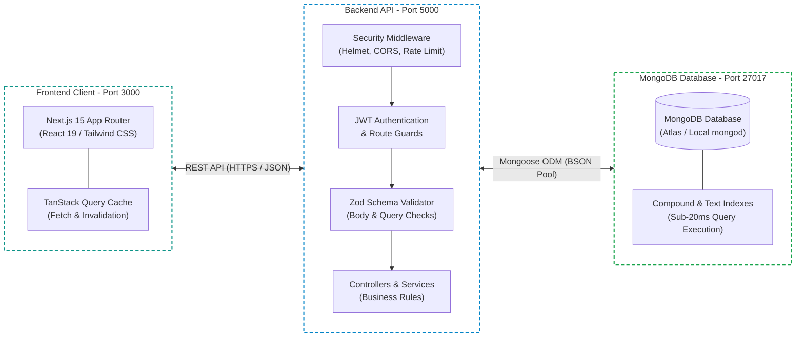

### Architectural Tiers

| Layer | Technology | Primary Responsibility |
| :--- | :--- | :--- |
| **Frontend Client** | Next.js 15, React 19, Tailwind CSS | Admin dashboard, responsive doctor/patient views, analytics charts, optimistic UI mutations |
| **Transport & API** | REST API, Express Router, JWT, Zod | API routing (`/api/v1`), route guards, input validation, rate limiting, security headers |
| **Backend Server** | Node.js, Express, TypeScript, Mongoose | Business logic, authentication, patient-to-doctor counter updates, aggregation pipelines |
| **Database** | MongoDB (6.0+), MongoDB Atlas | Document collections (`users`, `doctors`, `patients`), compound indexes, text search indexes |

---

# 3. How Data Moves Through the App

When an administrator searches, filters, or paginates records, the request follows an optimized, indexed path from the browser to MongoDB and back:

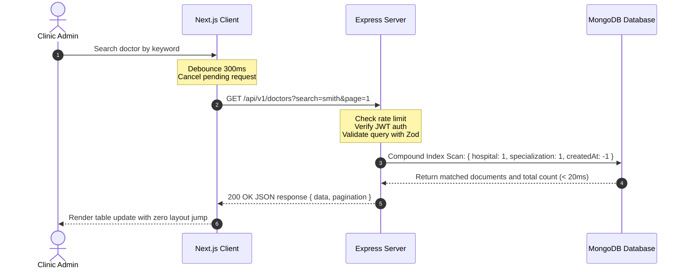

---

# 4. Core Capabilities

| Module | Capability | Feature Highlights |
| :--- | :--- | :--- |
| **Doctor Roster** | Profile Management | Register doctors with name, specialty, hospital, phone, and unique email. |
| **Doctor Roster** | Search & Filters | Filter by clinic, department, or registration date with instant debounced search. |
| **Doctor Roster** | Patient Drawer | Slide-out panel displaying assigned patients with quick add and discharge actions. |
| **Patient Directory** | Global Directory | Search patients by name, phone, or condition with server-side pagination. |
| **Patient Directory** | Urgency Status | Track cohorts by status: Admitted, Observation, Discharged. |
| **Patient Directory** | Safe Records | Edit demographics or discharge patients safely with confirmation modals. |
| **Analytics Dashboard** | Summary Metrics | Real-time counts for total doctors, patients, active in-bed cases, and discharged. |
| **Analytics Dashboard** | Visual Charts | Specialty distribution donut charts and daily/weekly intake timeline charts. |
| **Accessible UI** | Inclusive Design | WCAG 2.2 AA compliant clinical teal palette with 5 explicit states on every screen. |

---

# 5. Database Schema & Collections

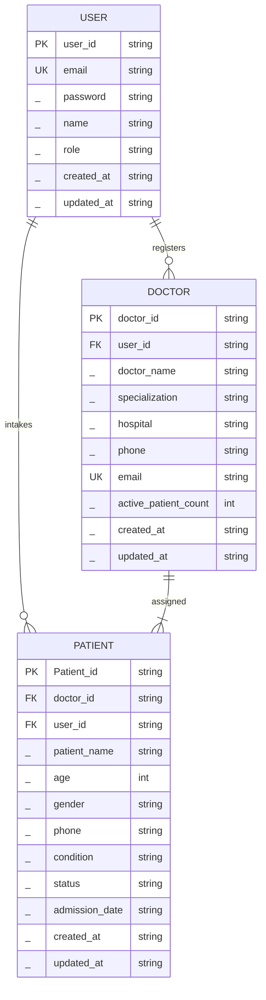

---

# 7. UI Component States

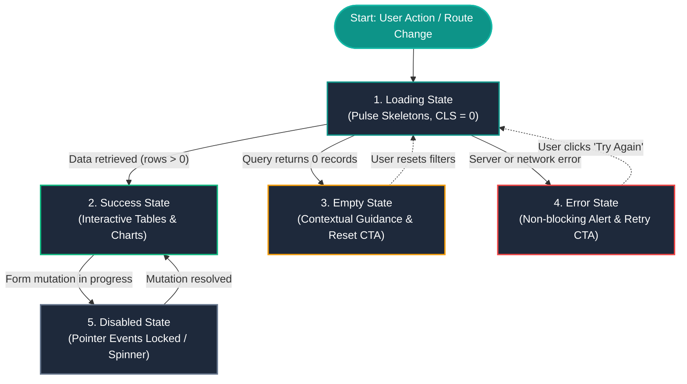

### Five Mandatory States

| State | Visual Behavior | Implementation Standard |
| :--- | :--- | :--- |
| **1. Loading** | Shimmer skeleton cards and table rows | Matches final dimensions to keep CLS under 0.1 |
| **2. Success** | Populated interactive data table and charts | Keyboard navigable with full server-side pagination |
| **3. Empty** | Contextual icon with guidance text | Includes a prominent "Reset Filters" action button |
| **4. Error** | Alert box with humanized error explanation | Includes an immediate "Try Again" recovery button |
| **5. Disabled** | Buttons dim to 60% opacity with mini spinner | Disables pointer events to prevent repeated clicks |

---

# 8. Technical Decisions

### Decision 1: Decoupled Next.js Client and Standalone Express Server
We separated the Next.js client from the Express backend instead of writing API route handlers inside Next.js. This maintains complete isolation between client bundles and backend security middleware, ensures Node.js server connections to MongoDB Atlas are long-lived and pooled rather than cold-started on edge lambdas, and provides a standalone REST API ready for future mobile apps.

### Decision 2: MongoDB Compound Indexing and Lean Aggregation Pipelines
We selected MongoDB with Mongoose because clinic documents (doctors and assigned patient rosters) benefit from flexible document schemas, atomic `$inc` counter updates on doctor cards, and multi-stage `$facet` aggregation pipelines. Using compound indexes `{ hospital: 1, specialization: 1, createdAt: -1 }` with Mongoose `.lean()` queries avoids full collection scans and hydrates raw JavaScript objects directly, guaranteeing sub-20ms response times for high-volume doctor and patient directories.

---

# 9. API Reference

Base URL: `https://doctor-tracker-backend-production.up.railway.app/api/v1`

### Authentication (`/api/v1/auth`)
| Method | Path | Description | Access |
| :--- | :--- | :--- | :--- |
| `POST` | `/auth/login` | Sign in with email and password, returns JWT | Public |
| `GET` | `/auth/me` | Return profile of currently signed-in user | Authenticated |

### Doctors (`/api/v1/doctors`)
| Method | Path | Description | Access |
| :--- | :--- | :--- | :--- |
| `GET` | `/doctors` | List doctors with search, filters, and pagination | Authenticated |
| `POST` | `/doctors` | Create a new doctor record | Authenticated |
| `GET` | `/doctors/:id` | Get details for one doctor | Authenticated |
| `PUT` | `/doctors/:id` | Update doctor details | Authenticated |
| `DELETE` | `/doctors/:id` | Delete doctor record | Authenticated |

### Patients (`/api/v1/patients`)
| Method | Path | Description | Access |
| :--- | :--- | :--- | :--- |
| `GET` | `/patients` | List patients with search, condition filter, and pagination | Authenticated |
| `POST` | `/patients` | Create a new patient record | Authenticated |
| `GET` | `/patients/:id` | Get details for one patient | Authenticated |
| `PUT` | `/patients/:id` | Update patient record | Authenticated |
| `DELETE` | `/patients/:id` | Delete patient record | Authenticated |

### Analytics (`/api/v1/analytics`)
| Method | Path | Description | Access |
| :--- | :--- | :--- | :--- |
| `GET` | `/analytics/summary` | Return KPI counts (total doctors, patients, status, trends) | Authenticated |

---

# 10. Visual Evidence (Desktop & Mobile Views)

High-resolution visual evidence captured from the production build, demonstrating WCAG 2.2 Level AA accessibility, 5-state UI coverage, dark theme tokens, and zero horizontal overflow across responsive viewports:

### Desktop Views

| Clinical Dashboard | Medical Practitioners Directory |
| :---: | :---: |
| 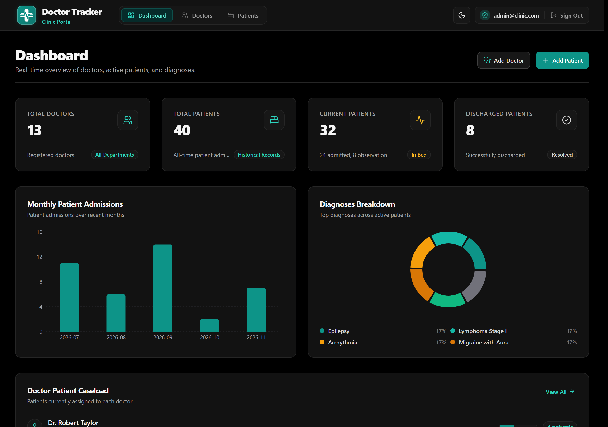 | 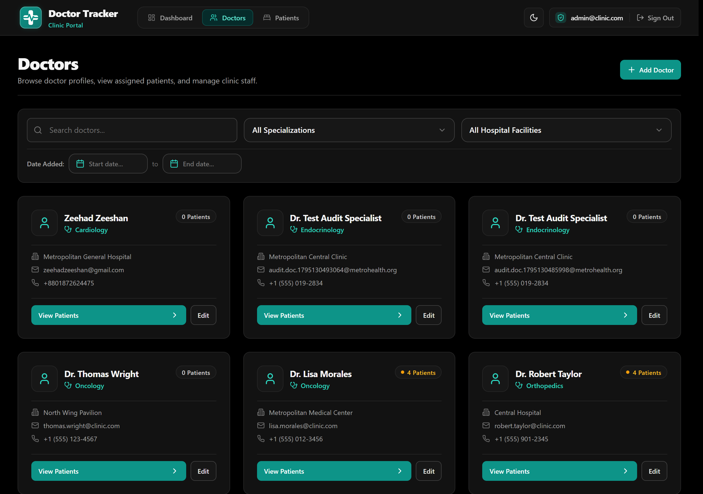 |

| Inpatient Management Directory | Clinical Staff Login |
| :---: | :---: |
| 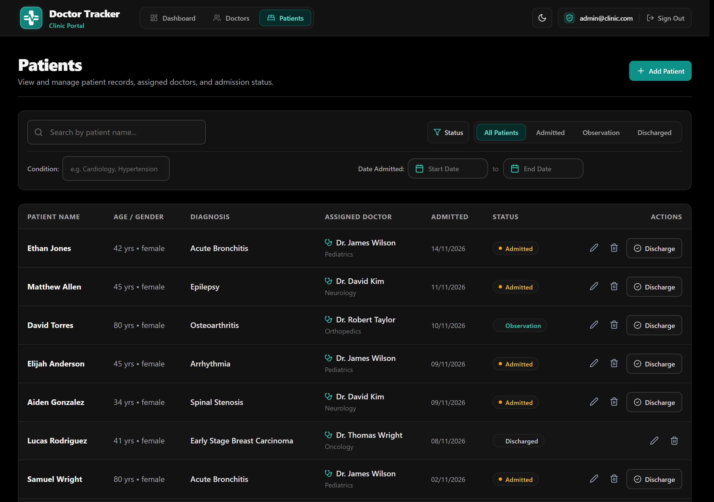 | 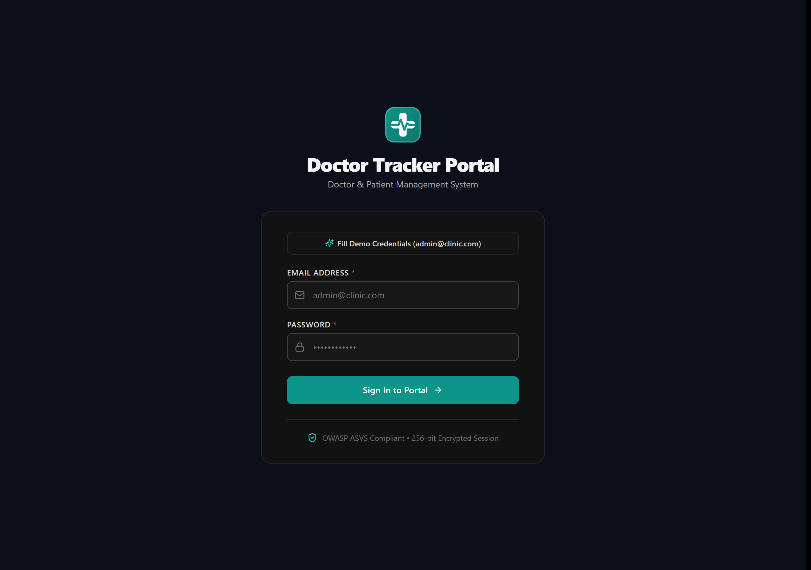 |

### Mobile Views (375px & 360px Viewports)

| Mobile Inpatient Management | Mobile Slide-Over Drawer | Mobile Navigation Menu |
| :---: | :---: | :---: |
| 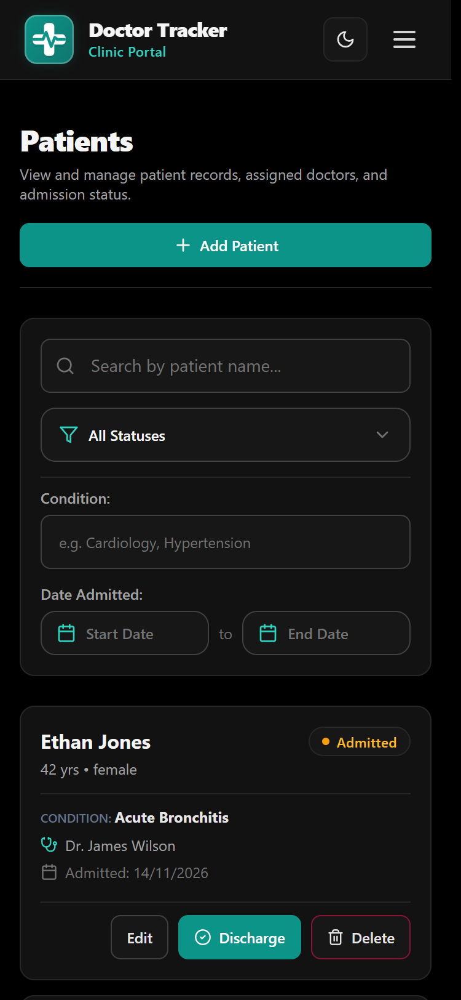 | 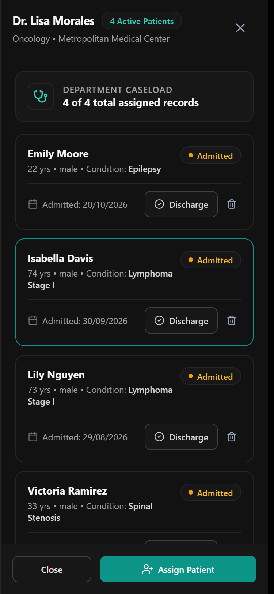 | 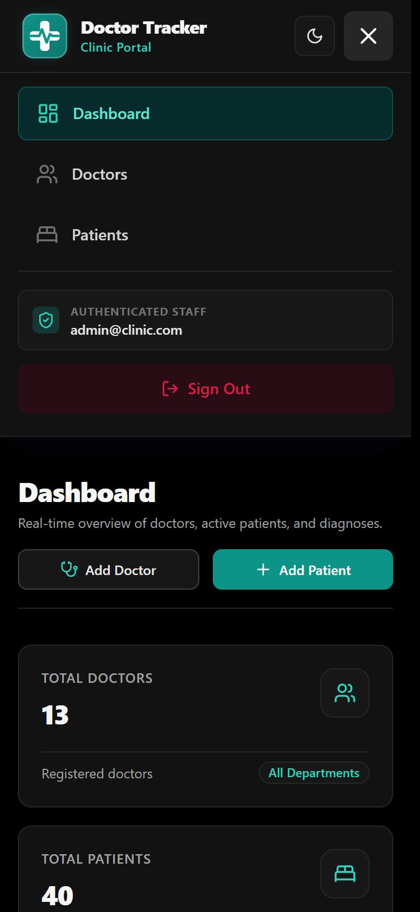 |

---

# 11. License

This project is licensed under the MIT License. See [LICENSE](LICENSE) for details.
