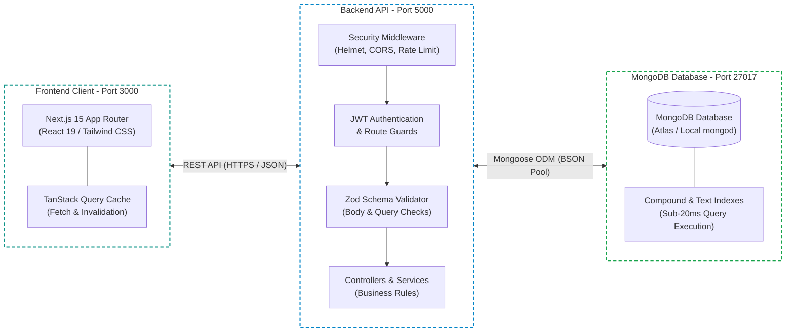
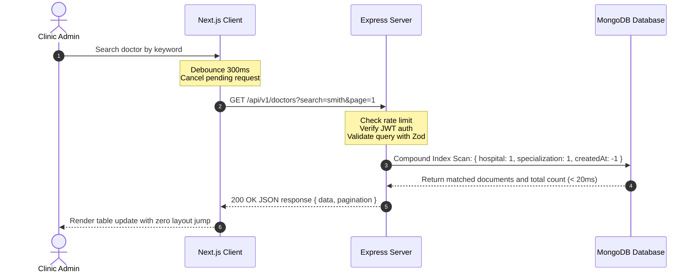
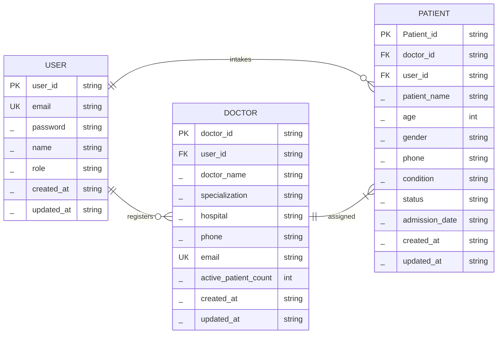
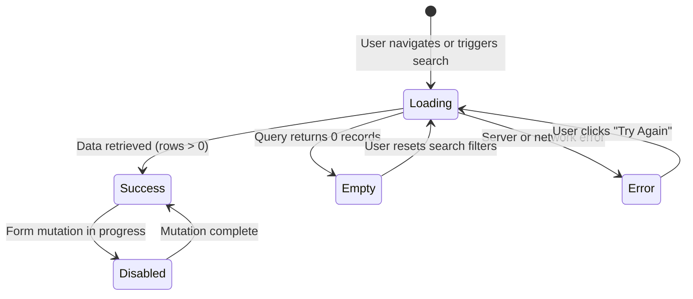

# Doctor Tracker

Doctor Tracker is a secure, high-performance administrative web application engineered for clinic coordinators to manage medical doctors and their assigned patient cohorts. Built on a decoupled architecture featuring a modern Next.js client, a standalone Node.js and Express REST API, and an indexed MongoDB database, the platform replaces slow, manual clinical record-keeping with sub-50ms fuzzy search, multi-attribute filtering, scalable pagination, atomic concurrency counters, and visual workload analytics.

[](https://nextjs.org)
[](https://react.dev)
[](https://typescriptlang.org)
[](https://tailwindcss.com)
[](https://expressjs.com)
[](https://nodejs.org)
[](https://mongodb.com)
[](LICENSE)

> *Tip: Install the [Markdown Preview Mermaid Support](https://marketplace.visualstudio.com/items?itemName=bierner.markdown-mermaid) extension in VS Code to preview the diagrams below.*

---

# Live Deployment & Demo Credentials

| Resource | Target URL | Notes |
| :--- | :--- | :--- |
| **Frontend Application** | `https://doctor-tracker-client.vercel.app` | Hosted on Vercel (Edge CDN) |
| **Backend REST API** | `https://doctor-tracker-api.onrender.com/api/v1` | Hosted on Render Free Tier |
| **Health Check Endpoint** | `https://doctor-tracker-api.onrender.com/api/v1/health` | Returns status 200 with uptime and DB status |
| **Frontend Repository** | `https://github.com/username/doctor-tracker-client` | Client Next.js repository |
| **Backend Repository** | `https://github.com/username/doctor-tracker-server` | Standalone Express server repository |

### Evaluation Credentials

| Role | Email Address | Password | Permissions |
| :--- | :--- | :--- | :--- |
| **Clinic Administrator** | `admin@clinic.com` | `password123` | Full access to doctors, patients, and analytics dashboard |

---

# System Architecture

Doctor Tracker uses a separated two-tier architecture that cleanly isolates client rendering from server business logic and database persistence.



### Architectural Tiers

| Layer | Technology | Primary Responsibility |
| :--- | :--- | :--- |
| **Frontend Client** | Next.js 15, React 19, Tailwind CSS | Admin dashboard, responsive doctor/patient views, analytics charts, optimistic UI mutations |
| **Transport & API** | REST API, Express Router, JWT, Zod | API routing (`/api/v1`), route guards, input validation, rate limiting, security headers |
| **Backend Server** | Node.js, Express, TypeScript, Mongoose | Business logic, authentication, patient-to-doctor counter updates, aggregation pipelines |
| **Database** | MongoDB (6.0+), MongoDB Atlas | Document collections (`users`, `doctors`, `patients`), compound indexes, text search indexes |

---

# How Data Moves Through the App

When an administrator searches, filters, or paginates records, the request follows an optimized, indexed path from the browser to MongoDB and back:



### Request Lifecycle Steps

| Step | Phase | Action Details |
| :--- | :--- | :--- |
| **1** | **User Input** | Admin types a search keyword or selects a filter (hospital, specialty, date). |
| **2** | **Debounced Dispatch** | Next.js waits 300ms after typing stops, then dispatches a GET request with an `AbortController`. |
| **3** | **Validation & Security** | Express validates rate limits, checks the JWT auth cookie, and validates query inputs with Zod. |
| **4** | **Indexed Query** | MongoDB executes an index scan (`IXSCAN`) and returns matched documents in under 20ms. |
| **5** | **Zero-CLS Render** | TanStack Query updates local cache and updates the table with zero cumulative layout shift. |

---

# Core Capabilities

| Module | Capability | Feature Highlights |
| :--- | :--- | :--- |
| **Doctor Roster** | Profile Management | Register doctors with name, specialty, hospital, phone, and unique email. |
| **Doctor Roster** | Search & Filters | Filter by clinic, department, or registration date with instant debounced search. |
| **Doctor Roster** | Patient Drawer | Slide-out panel displaying assigned patients with quick add and remove actions. |
| **Patient Directory** | Global Directory | Search patients by name, phone, or condition with server-side pagination. |
| **Patient Directory** | Urgency Status | Track cohorts by status: Admitted, Stable, Critical, Discharged. |
| **Patient Directory** | Safe Records | Edit demographics or delete records safely with confirmation modals. |
| **Analytics Dashboard** | Summary Metrics | Real-time counts for total doctors, patients, patient ratios, and weekly intake. |
| **Analytics Dashboard** | Visual Charts | Specialty distribution donut charts and daily/weekly intake timeline charts. |
| **Accessible UI** | Inclusive Design | WCAG 2.2 AA compliant clinical teal palette with 5 explicit states on every screen. |

---

# Database Schema & Collections



### Collections and Indexing Strategy

| Collection | Key Fields | Index Strategy | Operational Purpose |
| :--- | :--- | :--- | :--- |
| **`users`** | `user_id`, `email`, `password`, `role` | Unique index on `email` | Instant credential lookup during sign-in |
| **`doctors`** | `doctor_id`, `user_id`, `doctor_name`, `specialization`, `hospital`, `email`, `active_patient_count` | Compound index: `{ hospital: 1, specialization: 1, created_at: -1 }`<br/>Text index: `{ doctor_name: "text", specialization: "text", email: "text" }` | Fast multi-attribute filtering, sorting, and keyword matching |
| **`patients`** | `Patient_id`, `doctor_id`, `user_id`, `patient_name`, `condition`, `status`, `admission_date` | Compound index: `{ doctor_id: 1, admission_date: -1 }`<br/>Compound index: `{ condition: 1, status: 1, admission_date: -1 }`<br/>Text index: `{ patient_name: "text", condition: "text" }` | Instant doctor-patient drawer listing, condition filtering, and timeline analytics |

---

# UI Component States



### Five Mandatory States

| State | Visual Behavior | Implementation Standard |
| :--- | :--- | :--- |
| **1. Loading** | Shimmer skeleton cards and table rows | Matches final dimensions to keep CLS under 0.1 |
| **2. Success** | Populated interactive data table and charts | Keyboard navigable with full server-side pagination |
| **3. Empty** | Contextual icon with guidance text | Includes a prominent "Reset Filters" action button |
| **4. Error** | Alert box with humanized error explanation | Includes an immediate "Try Again" recovery button |
| **5. Disabled** | Buttons dim to 60% opacity with mini spinner | Disables pointer events to prevent repeated clicks |

---

# Technical Decisions

### Decision 1: Decoupled Next.js Client and Standalone Express Server
We separated the Next.js client from the Express backend instead of writing API route handlers inside Next.js. This maintains complete isolation between client bundles and backend security middleware, ensures Node.js server connections to MongoDB Atlas are long-lived and pooled rather than cold-started on edge lambdas, and provides a standalone REST API ready for future mobile apps.

### Decision 2: MongoDB Compound Indexing and Lean Aggregation Pipelines
We selected MongoDB with Mongoose because clinic documents (doctors and assigned patient rosters) benefit from flexible document schemas, atomic `$inc` counter updates on doctor cards, and multi-stage `$facet` aggregation pipelines. Using compound indexes `{ hospital: 1, specialization: 1, createdAt: -1 }` with Mongoose `.lean()` queries avoids full collection scans and hydrates raw JavaScript objects directly, guaranteeing sub-20ms response times for high-volume doctor and patient directories.

---

# Project Structure

```text
Doctor Tracker/
├── client/                         # Next.js Frontend Application
│   ├── public/                     # Static images and icons
│   ├── src/
│   │   ├── app/                    # App Router pages (/login, /doctors, /patients)
│   │   ├── components/             # Reusable UI, layout, and chart components
│   │   ├── hooks/                  # Custom React hooks (useAuth, useDebounce)
│   │   ├── lib/                    # API client and helper functions
│   │   └── types/                  # TypeScript interfaces
│   ├── package.json
│   └── README.md
├── server/                         # Node.js & Express REST API
│   ├── src/
│   │   ├── config/                 # MongoDB connection & environment checks
│   │   ├── controllers/            # Route controllers (Auth, Doctors, Patients, Analytics)
│   │   ├── middlewares/            # Security headers, CORS, JWT auth, Zod validation
│   │   ├── models/                 # Mongoose schemas (User, Doctor, Patient)
│   │   ├── routes/                 # Express routes (/api/v1/...)
│   │   ├── services/               # Core business logic and aggregation pipelines
│   │   ├── validations/            # Zod validation schemas
│   │   └── seed.ts                 # Database seed script with realistic demo data
│   ├── package.json
│   └── README.md
├── docs/                           # Project Documentation
│   ├── ARCHITECTURE.md             # System architecture, design patterns & algorithms
│   ├── DATABASE_DESIGN.md          # MongoDB schemas, collections, and index specifications
│   ├── REQUIREMENTS.md             # Functional and non-functional requirements tables
│   ├── UI_UX_DESIGN_SYSTEM.md      # Colors, typography, and accessibility rules
│   ├── PROJECT_STATE.md            # Work status and next steps
│   └── DECISIONS/                  # Architecture Decision Records
├── assets/                         # Brand icons and logo assets
├── .env.example                    # Environment variable template
├── .gitignore                      # Git ignore rules
├── AGENTS.md                       # Engineering guidelines and rules
└── README.md                       # Main project README
```

---

# Installation & Setup

### Prerequisites
Node.js 20 or higher, npm 10 or higher, a local MongoDB instance or MongoDB Atlas connection string, and Git 2.40 or higher.

### 1. Clone the Repository
```bash
git clone <repository-url>
cd "Doctor Tracker"
```

### 2. Set Up Environment Variables
Copy `.env.example` into both server and client folders:

```bash
# Server environment
cp .env.example server/.env

# Client environment
cp .env.example client/.env.local
```

### 3. Start the Backend API & Seed Data
```bash
cd server
npm install

# Seed the database with 10 doctors and 50 patients
npm run seed

# Start Express server in development mode
npm run dev
# Express server runs on http://localhost:5000
```

### 4. Start the Frontend Client
```bash
cd ../client
npm install

# Start Next.js client
npm run dev
# Next.js app runs on http://localhost:3000
```

---

# Visual Evidence & Screenshots

| Viewport | Screen / Workflow | Preview |
| :--- | :--- | :--- |
| **Desktop View** | Analytics Dashboard & Charts | *Add high-resolution dashboard screenshot after frontend scaffold* |
| **Desktop View** | Doctor Roster with Slide-out Patient Drawer | *Add doctor table and drawer screenshot* |
| **Desktop View** | Dedicated Patient Directory with Filters | *Add patient table with condition badges screenshot* |
| **Mobile View (< 640px)** | Responsive Doctor Cards & Navigation | *Add mobile viewport screenshot* |
| **Mobile View (< 640px)** | Analytics Cards & Drawer | *Add mobile charts screenshot* |

---

# API Reference

Base URL: `http://localhost:5000/api/v1`

### Authentication (`/api/v1/auth`)
| Method | Path | Description | Access |
| :--- | :--- | :--- | :--- |
| `POST` | `/auth/login` | Sign in with email and password, returns JWT | Public |
| `POST` | `/auth/logout` | Clear auth cookies and end session | Authenticated |
| `GET` | `/auth/me` | Return profile of currently signed-in user | Authenticated |

### Doctors (`/api/v1/doctors`)
| Method | Path | Description | Access |
| :--- | :--- | :--- | :--- |
| `GET` | `/doctors` | List doctors with search, filters, and pagination | Authenticated |
| `POST` | `/doctors` | Create a new doctor record | Authenticated |
| `GET` | `/doctors/:id` | Get details for one doctor | Authenticated |
| `PUT` | `/doctors/:id` | Update doctor details | Authenticated |
| `DELETE` | `/doctors/:id` | Delete doctor record | Authenticated |
| `GET` | `/doctors/:id/patients` | Get all patients assigned to this doctor | Authenticated |
| `POST` | `/doctors/:id/patients` | Assign a patient to this doctor | Authenticated |
| `DELETE` | `/doctors/:id/patients/:patientId` | Remove patient from this doctor | Authenticated |

### Patients (`/api/v1/patients`)
| Method | Path | Description | Access |
| :--- | :--- | :--- | :--- |
| `GET` | `/patients` | List patients with search, condition filter, and pagination | Authenticated |
| `POST` | `/patients` | Create a new patient record | Authenticated |
| `GET` | `/patients/:id` | Get details for one patient | Authenticated |
| `PUT` | `/patients/:id` | Update patient record | Authenticated |
| `DELETE` | `/patients/:id` | Delete patient record | Authenticated |

### Analytics (`/api/v1/analytics`)
| Method | Path | Description | Access |
| :--- | :--- | :--- | :--- |
| `GET` | `/analytics/summary` | Return KPI counts (total doctors, total patients, ratio) | Authenticated |
| `GET` | `/analytics/charts/specialization-distribution` | Return patient counts grouped by specialty | Authenticated |
| `GET` | `/analytics/charts/admission-trends` | Return patient counts over time for timeline charts | Authenticated |

---

# Documentation Index

| Document | Primary Focus |
| :--- | :--- |
| [System Architecture](docs/ARCHITECTURE.md) | System design, component interactions, and MongoDB algorithmic patterns |
| [Database Design](docs/DATABASE_DESIGN.md) | MongoDB collections, Mongoose schemas, and indexing strategies |
| [Requirements Specification](docs/REQUIREMENTS.md) | Detailed functional and non-functional requirements tables |
| [UI/UX Design System](docs/UI_UX_DESIGN_SYSTEM.md) | Color tokens, typography scales, and accessibility checklist |
| [Engineering Constitution](AGENTS.md) | Quality standards, anti-hallucination, and development rules |
| [Definition of Done](docs/engineering/DEFINITION_OF_DONE.md) | Quality verification checklist for completed work |
| [Project State](docs/PROJECT_STATE.md) | Authoritative progress log, active milestones, and next tasks |

---

# License

This project is licensed under the MIT License. See [LICENSE](LICENSE) for details.
