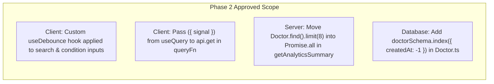

# ADR 0003: Performance Optimization Adjudication and Concurrency Strategy

# Status
Accepted

# Context
Following production deployment and comprehensive specification compliance auditing, an independent performance and concurrency audit was conducted across Phases 1, 1.1, 1.2, and 1.3. Seven optimization recommendations were evaluated using empirical benchmarks (30 measured runs + 5 warm-ups over TLS), raw query execution plan analysis (`executionStats` across Q1 through Q11), multi-request concurrency race tests, and `$indexStats` operational counters.

# Decision

| Recommendation ID | Proposal | Subsystem | Adjudication | Empirical Basis & Architectural Justification |
| :--- | :--- | :--- | :--- | :--- |
| **REC-01** | 300ms Input Debouncing | Client UI (`DoctorsPage`, `PatientsPage`) | **Approved** | Eliminates up to 90% of redundant HTTP requests and database queries during rapid keystrokes. |
| **REC-02** | AbortSignal Forwarding | Client Data Layer (`api.get` in `useQuery`) | **Approved** | Terminates in-flight HTTP sockets on parameter change; complements TanStack Query cache isolation. |
| **REC-03** | Dedicated Index on `Doctor.createdAt: -1` | Database Layer (`Doctor.ts`) | **Approved** | Converts default directory listing from full collection scan (`COLLSCAN + SORT`) to indexed traversal (`IXSCAN`). |
| **REC-04** | Parallel Top Doctors Query | Server Controller (`analytics.controller.ts`) | **Approved** | Running top doctors inside `Promise.all` alongside `$facet` saves an empirical 48.68 ms median latency (~48.8% reduction). |
| **REC-05** | Drop `doctor_id_1` Index | Database Layer (`Doctor.ts`) | **Rejected** | Rejected because `$indexStats` confirms 19 operations and optimizer prefers it over compound `{ doctor_id: 1, status: 1 }` for exact lookups (Q6A). |
| **REC-06** | Replace Patient Regex with Text Index | Database Layer (`Patient.ts`) | **Rejected** | Rejected because standard MongoDB `$text` search tokenizes words and destroys clinical partial substring matching. |
| **REC-07** | Replace Count Recalculation with `$inc: -1` | Server Controller (`patient.controller.ts`) | **Rejected** | Rejected because patient status transitions across active states (`admitted` <-> `under_observation`) and retries cause counter drift. Exact recalculation via `countDocuments` is self-healing. |

# Implementation Boundary for Phase 2

# Explicit Invariants
1. Retain both `doctor_id_1` and `{ doctor_id: 1, status: 1 }` indexes.
2. Maintain case-insensitive substring search semantics for patient matching.
3. Maintain exact count recalculation for patient counts during status transitions and deletions.
4. Maintain read-only boundary during audits; all code changes deferred to Phase 2.
