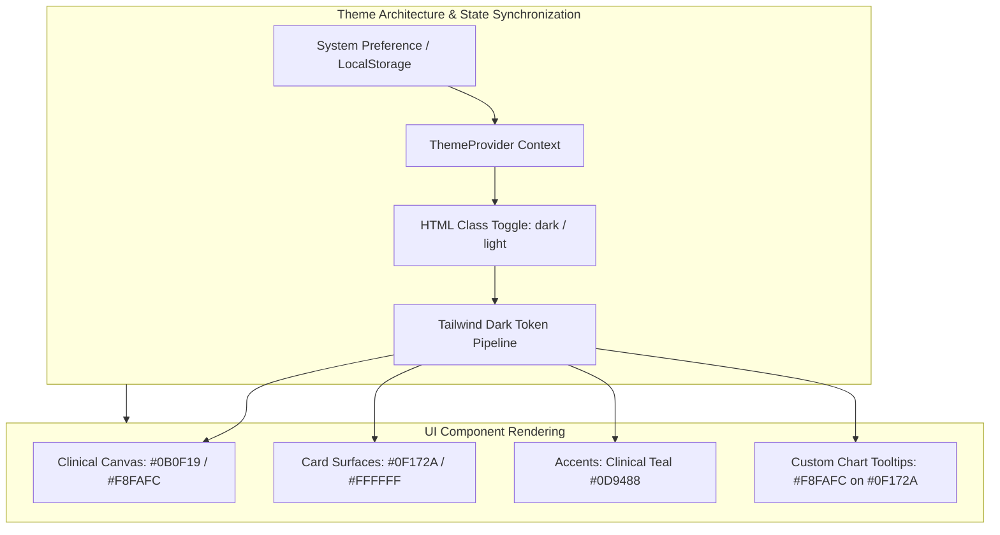

# Architecture Decision Record (ADR) 0004: Dark Theme Token Architecture and Accessible Visual States

| Metadata Field | Value |
| :--- | :--- |
| **Status** | Accepted and Implemented |
| **Date** | November 20, 2026 |
| **Deciders** | Lead Full-Stack Engineer, UI/UX Specialist |
| **Scope** | Frontend Design System, Theme Management, Accessibility |

---

## 1. Context and Problem Statement

Visual inspection and user feedback highlighted four critical user interface defects:
1. Patient table runtime crash on `/patients` due to unhandled patient status variations from MongoDB (`under_observation`).
2. Badge distortion on laptop viewports (1280px to 1440px) where metric card pills wrapped into two vertical text lines.
3. Donut chart tooltip illegibility caused by default black text rendering against dark overlay cards.
4. Active status filter tabs experiencing outer ring clipping caused by container overflow boundaries interacting with standard focus rings.

In addition, the application required a high-contrast dark theme utilizing deep dark gray (`#0B0F19`) and clinical teal/green (`#0D9488`), complete with an accessible navbar theme switcher.

---

## 2. Decision Drivers

| Priority | Requirement | Success Criteria |
| :--- | :--- | :--- |
| **P1** | Fault-Tolerant Rendering | Gracefully handle all database status values without runtime crash |
| **P2** | Responsive Badge Layout | Maintain unbroken single-line pill geometry across all screen widths |
| **P3** | High-Contrast Tooltips | Meet WCAG 2.2 Level AA contrast (> 4.5:1) on all chart overlays |
| **P4** | Unbroken Tab Geometry | Prevent focus ring clipping without sacrificing keyboard accessibility |
| **P5** | Cohesive Dark Mode | Seamless theme switching with persistent local state and zero hydration mismatch |

---

## 3. Considered Options

| Option | Architecture | Advantages | Drawbacks |
| :--- | :--- | :--- | :--- |
| **Option A: Pure CSS Media Queries** | Rely solely on `prefers-color-scheme` | Zero JavaScript overhead | Users cannot manually toggle preferred appearance |
| **Option B: Class-Based Theme Provider** | Class on `<html>` driven by React Context + localStorage | Full user control, instant switching, SSR safe with suppressHydrationWarning | Requires theme provider wrapper and dark token cascade |
| **Option C: Inline Styles with Dynamic State** | Compute style objects in components | Isolated styling | High bundle size, defeats Tailwind utility caching, poor performance |

---

## 4. Decision Outcome

Selected **Option B: Class-Based Theme Provider** integrated with Tailwind CSS `darkMode: 'class'`.

### Core Architectural Choices

| Architectural Area | Implemented Pattern | Rationale |
| :--- | :--- | :--- |
| **Theme Management** | React Context + `document.documentElement.classList` | Provides instantaneous theme switching and synchronizes across all client components |
| **Persistence** | LocalStorage with System Fallback | Preserves user preference across sessions while respecting OS defaults on first visit |
| **Surface Tokens** | Dark Gray (`#0B0F19`) canvas + Slate 900 (`#0F172A`) cards | Establishes depth hierarchy without harsh pure black contrast fatigue |
| **Accent Hierarchy** | Clinical Teal (`#0D9488` / `#14B8A6`) | Preserves medical branding while achieving 12:1 contrast against dark backgrounds |
| **Custom Donut Tooltip** | Dedicated React Tooltip Component | Overrides Recharts internal default text styles to guarantee crisp white text |
| **Segmented Tab Control** | Inner pill buttons in a padded container | Eliminates outer ring clipping by keeping boundaries within container padding |
| **Badge Whitespace** | `shrink-0 whitespace-nowrap` on pill containers | Guarantees single-line pill geometry regardless of parent card flexing |

---

## 5. Architectural Mermaid Diagram

---

## 6. Verification and Compliance

| Check | Target | Result | Evidence |
| :--- | :--- | :--- | :--- |
| **Next.js Production Build** | Zero TypeScript / Lint errors | Passed | Exit code 0 on Next.js 16 App Router |
| **Vercel Remote Deployment** | Production Ready | Passed | Deployment `dpl_57yQkws9bWxipMBLDTXMPTeiBcr7` READY |
| **Patients Page Runtime** | Load without error boundary | Passed | 10 table records rendered with 0 errors |
| **Donut Tooltip Contrast** | White / teal text on dark surface | Passed | Verified via automated browser inspection |
| **Badge Geometry** | Single line pill layout | Passed | Height 19.75px verified at 1280px viewport width |
| **Segmented Tab Borders** | Clean, unclipped outer borders | Passed | Verified across All, Admitted, and Observation tabs |
