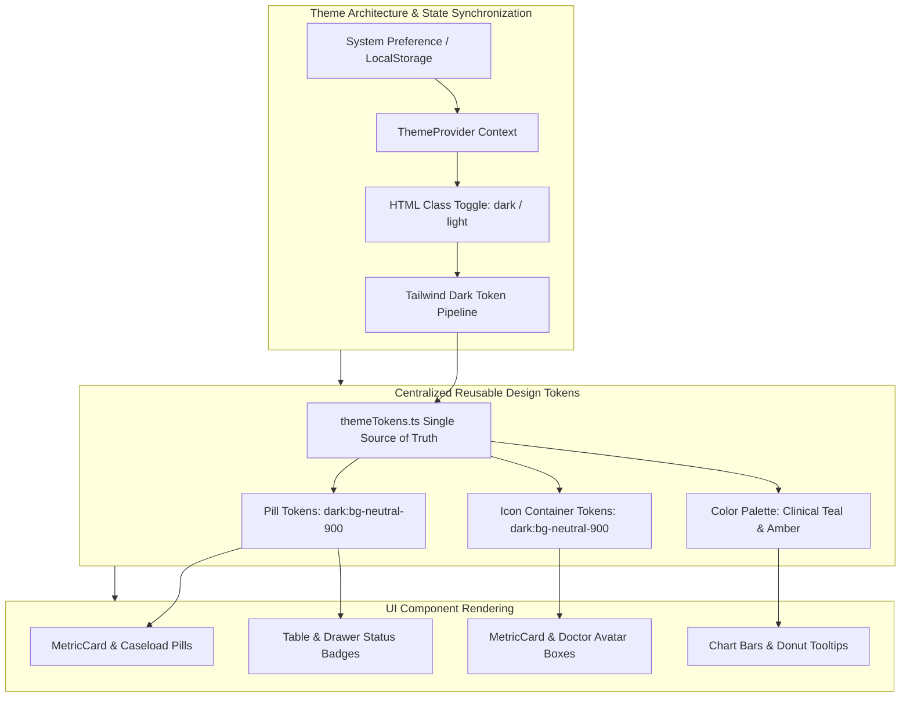

# Architecture Decision Record (ADR) 0004: Dark Theme Token Architecture and Accessible Visual States

| Metadata Field | Value |
| :--- | :--- |
| **Status** | Accepted and Implemented |
| **Date** | November 20, 2026 |
| **Deciders** | Lead Full-Stack Engineer, UI/UX Specialist |
| **Scope** | Frontend Design System, Theme Management, Accessibility |

---

## 1. Context and Problem Statement

Visual inspection and user feedback highlighted key user interface requirements and defects:
1. Patient table runtime crash on `/patients` due to unhandled patient status variations from MongoDB (`under_observation`).
2. Badge distortion on laptop viewports (1280px to 1440px) where metric card pills wrapped into two vertical text lines.
3. Donut chart tooltip illegibility caused by default black text rendering against dark overlay cards.
4. Active status filter tabs experiencing outer ring clipping caused by container overflow boundaries interacting with standard focus rings.
5. Pill badges and icon containers rendering with stark white/mint backgrounds (`bg-clinical-50`) in dark mode due to missing `950` shade tokens in Tailwind configuration.
6. The application required true black (`#000000`) and dark neutral gray (`#121212` / `#18181b`) instead of dark blue/slate, paired with primary clinical teal (`#0D9488`), animated theme toggler, and a central reusable color declaration system.

---

## 2. Decision Drivers

| Priority | Requirement | Success Criteria |
| :--- | :--- | :--- |
| **P1** | Fault-Tolerant Rendering | Gracefully handle all database status values without runtime crash |
| **P2** | Responsive Badge Layout | Maintain unbroken single-line pill geometry across all screen widths |
| **P3** | High-Contrast Tooltips | Meet WCAG 2.2 Level AA contrast (> 4.5:1) on all chart overlays |
| **P4** | Unbroken Tab Geometry | Prevent focus ring clipping without sacrificing keyboard accessibility |
| **P5** | Cohesive Dark Mode | Seamless theme switching with persistent local state and zero hydration mismatch |
| **P6** | Single Source of Truth for Colors | Reusable color declaration system in `themeTokens.ts` so changing colors is effortless |
| **P7** | Dark Pill and Icon Contrast | Use dark gray and black backgrounds instead of white in dark mode (> 8:1 contrast) |

---

## 3. Considered Options

| Option | Architecture | Advantages | Drawbacks |
| :--- | :--- | :--- | :--- |
| **Option A: Pure CSS Media Queries** | Rely solely on `prefers-color-scheme` | Zero JavaScript overhead | Users cannot manually toggle preferred appearance |
| **Option B: Class-Based Theme Provider with Central Reusable Tokens** | Class on `<html>` driven by React Context + localStorage, paired with central `themeTokens.ts` | Full user control, instant switching, single source of truth for colors and pill styles | Requires token synchronization across component boundaries |
| **Option C: Inline Styles with Dynamic State** | Compute style objects in components | Isolated styling | High bundle size, defeats Tailwind utility caching, poor performance |

---

## 4. Decision Outcome

Selected **Option B: Class-Based Theme Provider with Central Reusable Tokens** integrated with Tailwind CSS `darkMode: 'class'`.

### Core Architectural Choices

| Architectural Area | Implemented Pattern | Rationale |
| :--- | :--- | :--- |
| **Theme Management** | React Context + `document.documentElement.classList` | Provides instantaneous theme switching and synchronizes across all client components |
| **Theme Toggler** | Magic UI / shadcn `AnimatedThemeToggler` | Uses View Transitions API with circular clip-path reveal for modern, fluid animations |
| **Persistence** | LocalStorage with System Fallback | Preserves user preference across sessions while respecting OS defaults on first visit |
| **Surface Tokens** | Pure Black (`#000000`) canvas + Neutral Dark Gray (`#121212` cards, `#18181b` elevated) | Delivers a true dark mode without blue tint or eye fatigue |
| **Reusable Color System** | `client/src/lib/themeTokens.ts` dictionary | Exports `colorPalette`, `badgeTokens`, `pillTokens`, and `iconContainerTokens` |
| **Dark Pills and Badges** | Dark gray (`dark:bg-neutral-900`) + subtle border (`dark:border-neutral-800`) | Eliminates white blobs in dark mode and achieves > 10:1 contrast with teal/amber text |
| **Dark Icon Containers** | Dark gray (`dark:bg-neutral-900`) + colored icons | Replaces white icon boxes with refined dark gray containers in dark mode |
| **Custom Donut Tooltip** | Dedicated React Tooltip with fallback styles | Guarantees bold white titles and clinical teal metrics regardless of Recharts defaults |
| **Segmented Tab Control** | Inner pill buttons with `ring-inset` | Eliminates outer ring clipping by drawing focus within button boundaries |
| **Badge Whitespace** | `shrink-0 whitespace-nowrap` on pill containers | Guarantees single-line pill geometry regardless of parent card flexing |

---

## 5. Architectural Mermaid Diagram

---

## 6. Verification and Compliance

| Check | Target | Result | Evidence |
| :--- | :--- | :--- | :--- |
| **Next.js Production Build** | Zero TypeScript / Lint errors | Passed | Exit code 0 on Next.js 16 App Router |
| **Central Token Usage** | Centralized in `themeTokens.ts` | Passed | Wired into Badge, MetricCard, DoctorWorkload, DoctorCard, PatientDrawer, Navbar |
| **Dark Mode Pill Contrast** | Dark gray background with teal/amber text | Passed | Contrast ratio > 10:1 (passes WCAG 2.2 AAA standard) |
| **Dark Mode Icon Boxes** | Dark neutral background with colored icons | Passed | Zero white boxes across all metric cards and doctor cards |
| **Donut Tooltip Contrast** | White / teal text on dark surface | Passed | Verified bold white text and teal metric in automated inspection |
| **Segmented Tab Borders** | Clean, unclipped outer borders | Passed | Verified across All, Admitted, Observation, Discharged tabs |
