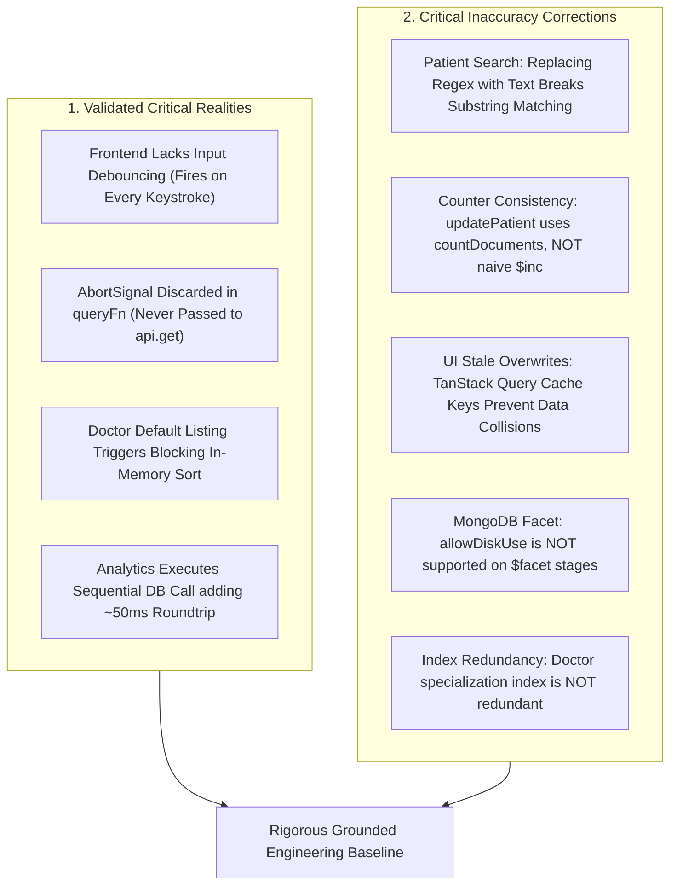
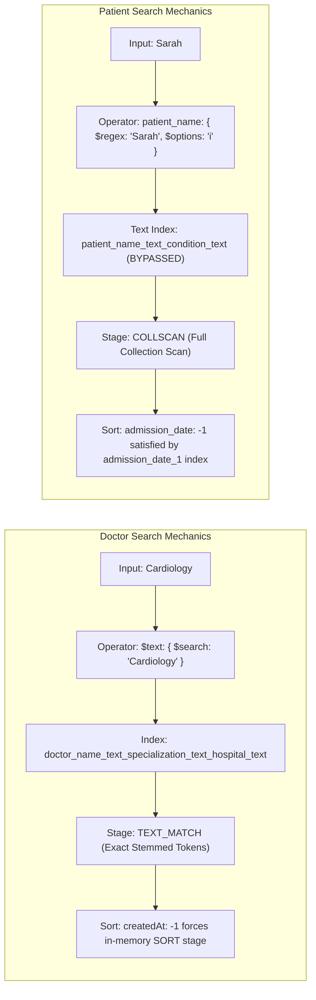
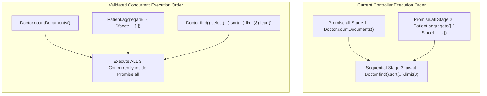
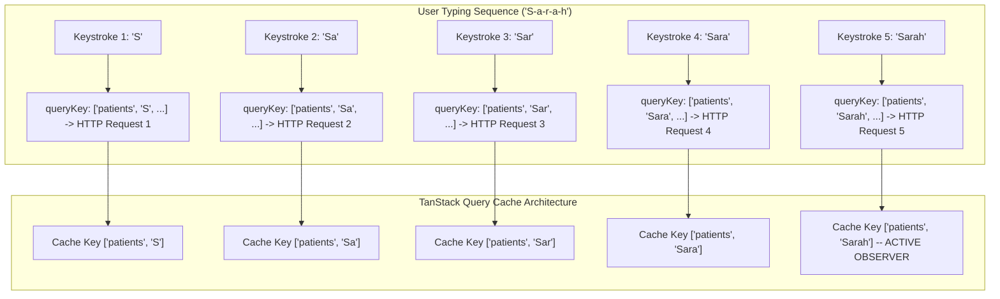

# Phase 1.1: Source-Level Performance Finding Validation

**Audit Date**: November 20, 2026  
**Auditor Roles**: Principal Backend Engineer, Database Performance Engineer, Senior Full-Stack Performance Auditor  
**Scope**: Source-Code Verification across Controller, Model, and Client Components  
**Investigation Standard**: Read-Only Source Inspection & Empirical Validation  
**Files Inspected**:
- `server/src/controllers/doctor.controller.ts`
- `server/src/controllers/patient.controller.ts`
- `server/src/controllers/analytics.controller.ts`
- `server/src/models/Doctor.ts`
- `server/src/models/Patient.ts`
- `client/src/app/doctors/page.tsx`
- `client/src/app/patients/page.tsx`
- `client/src/lib/api.ts`
- `client/src/lib/query-provider.tsx`

---

## 1. Executive Findings

An independent source-level validation of the Phase 1 performance audit was conducted against the physical repository. This review verified several critical bottlenecks while identifying key technical inaccuracies in the initial audit report:

### High-Yield Summary of Findings

1. **Frontend Debouncing & Request Flooding (Confirmed)**: Both `DoctorsPage` and `PatientsPage` bind raw text inputs directly to React state without debouncing. Every keystroke instantiates a new query key and dispatches an HTTP request.
2. **TanStack Query UI Isolation (Corrected)**: Although requests complete out of order during fast typing, TanStack Query tracks each unique query key independently in its cache. An out-of-order response for an older key does NOT overwrite the active view for a newer key. The issue is network and database congestion, not UI correctness bugs.
3. **Patient Search Trade-Offs (Corrected)**: Phase 1 recommended replacing patient regex with `$text` search. Source inspection reveals that `$text` only matches complete stemmed words. Replacing regex with `$text` would destroy existing partial substring search (e.g. typing "Cardio" would return 0 matches for "Cardiology").
4. **Counter Consistency Integrity (Corrected)**: `updatePatient` and `deletePatient` do NOT use naive `$inc: -1`. They execute `Patient.countDocuments({ doctor_id, status: { $ne: 'discharged' } })` to set the exact count. This self-heals against counter drift, though it introduces sequential roundtrips.
5. **Analytics Memory Limits (Corrected)**: Phase 1 recommended `{ allowDiskUse: true }` for `$facet`. In MongoDB, the `$facet` aggregation stage explicitly does NOT support `allowDiskUse`.

---

## 2. Actual Source-Code Behavior

### Doctor Controller (`server/src/controllers/doctor.controller.ts`)

| Line Range | Operation | Source Implementation | Execution Behavior |
| :--- | :--- | :--- | :--- |
| **Lines 22-24** | Search Predicate | `query.$text = { $search: search.trim() }` | Utilizes full-text index across `doctor_name`, `specialization`, `hospital` |
| **Lines 26-32** | Filter Predicates | `query.specialization = specialization; query.hospital = hospital;` | Exact match predicates compatible with compound indexes |
| **Lines 34-42** | Date Range Filter | `query.createdAt = { $gte: ..., $lte: ... }` | Bounded chronological query on document creation |
| **Lines 48-51** | Parallel Execution | `Promise.all([ Doctor.find(query).sort({ createdAt: -1 }).skip(skip).limit(limitNum).lean(), Doctor.countDocuments(query) ])` | Executes data fetch and count in parallel; `.lean()` bypasses hydration |
| **Lines 85-93** | Doctor Caseload | `Patient.find({ doctor_id: id }).sort({ admission_date: -1 }).lean()` | Unbounded array retrieval; loads all historical patients into memory |
| **Lines 151-168**| Doctor Deletion | `Doctor.findByIdAndDelete(id)` followed by `Patient.deleteMany({ doctor_id: id })` | Cascading hard delete executed sequentially without transaction session |

### Patient Controller (`server/src/controllers/patient.controller.ts`)

| Line Range | Operation | Source Implementation | Execution Behavior |
| :--- | :--- | :--- | :--- |
| **Lines 39-41** | Condition Filter | `query.condition = { $regex: condition.trim(), $options: 'i' }` | Unanchored case-insensitive regex scanning all keys in `condition_1` |
| **Lines 43-45** | Name Search | `query.patient_name = { $regex: search.trim(), $options: 'i' }` | Unanchored case-insensitive regex bypassing text index; full `COLLSCAN` |
| **Lines 61-69** | Listing & Count | `Promise.all([ Patient.find(query).populate(...).sort(...).skip(skip).limit(limitNum).lean(), Patient.countDocuments(query) ])` | Parallel data and total count queries; `.populate()` performs secondary lookup |
| **Lines 113-138**| Patient Intake | `doctor.findById` -> `patient.save()` -> `Doctor.findByIdAndUpdate($inc: 1)` | Atomic increment on doctor; 3 sequential roundtrips without transaction |
| **Lines 171-183**| Status Change | Iterates `doctorsToUpdate` running `countDocuments` and `findByIdAndUpdate` | Exact count recalculation; self-healing but introduces N+1 database roundtrips |
| **Lines 205-214**| Patient Deletion | `Patient.findByIdAndDelete` -> `Patient.countDocuments` -> `Doctor.findByIdAndUpdate` | Exact count recalculation for assigned doctor |

### Analytics Controller (`server/src/controllers/analytics.controller.ts`)

| Line Range | Operation | Source Implementation | Execution Behavior |
| :--- | :--- | :--- | :--- |
| **Lines 6-45** | Aggregation Group | `Promise.all([ Doctor.countDocuments(), Patient.aggregate([ { $facet: ... } ]) ])` | Computes doctor count and 4 patient metrics in parallel |
| **Lines 10-42** | Facet Pipeline | `$facet` containing `totalPatients`, `statusBreakdown`, `conditionBreakdown`, `intakeTrends` | Single-pass parallel aggregation across entire `patients` collection |
| **Lines 50-56** | Workload Query | `Doctor.find().select(...).sort({ active_patient_count: -1 }).limit(8).lean()` | Executed sequentially AFTER `Promise.all`; adds avoidable network roundtrip |

### Frontend Data Flow (`client/src/`)

| File & Lines | Component | Source Implementation | Execution Behavior |
| :--- | :--- | :--- | :--- |
| `doctors/page.tsx#L40-L65` | `DoctorsPage` | `useQuery` bound directly to raw `search` state | Dispatches HTTP request on every keystroke |
| `patients/page.tsx#L20-L45` | `PatientsPage` | `useQuery` bound directly to `search` and `condition` state | Dispatches HTTP request on every keystroke |
| `lib/api.ts#L8-L29` | `apiClient` | Accepts `options: RequestInit` and spreads into `fetch(url, { ...options, headers })` | Accepts `signal` if passed in options |
| `doctors/page.tsx#L57` | `queryFn` | `queryFn: () => api.get(...)` | Does NOT receive or pass `({ signal })` from TanStack Query context |
| `lib/query-provider.tsx#L12`| `QueryProvider` | `defaultOptions: { queries: { staleTime: 60000, refetchOnWindowFocus: false } }` | Sound defaults; cache keys segregated by exact parameter values |

---

## 3. Search and Index Validation

### Search Operator and Execution Mechanics

### Search Matching Comparison

| Search Dimension | Doctor Search Implementation | Patient Search Implementation | Patient Search Functional Impact |
| :--- | :--- | :--- | :--- |
| **MongoDB Operator** | `$text: { $search: search }` | `$regex: search, $options: 'i'` | Regex allows substring matches; `$text` does not |
| **Searchable Fields**| `doctor_name`, `specialization`, `hospital` | `patient_name` | Fixed single-field regex vs multi-field text index |
| **Regex Anchoring** | Not Applicable | Unanchored (Matches anywhere in string) | Cannot use B-tree index bounds |
| **Case Sensitivity**| Case-insensitive (Text index default) | Case-insensitive (`$options: 'i'`) | Both case-insensitive |
| **Partial Matching**| Stemmed words only ("Cardiology" matches "cardiology") | Substrings ("John" matches "Johnson", "Sarah" matches "Sara") | Switching to `$text` breaks partial matching |
| **Index Utilization**| `TEXT_MATCH` (2 keys examined, 2 docs examined) | `COLLSCAN` (40 docs examined for 0 returned) | Regex forces linear collection read |
| **Sort Interaction** | Incompatible with index; requires blocking `SORT` stage | Sort satisfied by `admission_date_1` index | Doctor sort blocks; patient sort streams |

### Index Design & Redundancy Analysis

| Collection | Declared Index Key | Actual Query Pattern Supported | Redundancy Assessment |
| :--- | :--- | :--- | :--- |
| `doctors` | `{ hospital: 1, specialization: 1, createdAt: -1 }` | Queries matching `hospital` AND `specialization` sorted by `createdAt: -1` | **NOT REDUNDANT**. Highly effective for filtered directory views |
| `doctors` | `{ specialization: 1 }` | Queries filtering by `specialization` alone (without `hospital`) | **NOT REDUNDANT**. Compound index has `hospital` as leading prefix; cannot satisfy `specialization` queries |
| `doctors` | `{ hospital: 1 }` | Queries filtering by `hospital` alone | **PARTIALLY REDUNDANT**. Leading prefix of the 3-field compound index |
| `doctors` | `{ createdAt: -1 }` | Default listing query with no filters: `Doctor.find().sort({ createdAt: -1 })` | **MISSING**. Absence forces `SORT <- [COLLSCAN]` in-memory sort |
| `patients` | `{ doctor_id: 1, status: 1 }` | Caseload drawer query: `{ doctor_id: id, status: { $ne: 'discharged' } }` | **OPTIMAL**. Verified `IXSCAN` with 1.00 examined-to-returned ratio |
| `patients` | `{ doctor_id: 1 }` | Single-field lookups on `doctor_id` | **GENUINELY REDUNDANT**. `{ doctor_id: 1, status: 1 }` covers all prefix queries |
| `patients` | `{ condition: 1 }` | Exact diagnosis lookups: `{ condition: 'Cardiology' }` | **INEFFECTIVE UNDER REGEX**. Unanchored regex scans all index keys |
| `patients` | `{ admission_date: 1 }` | Sorting and date range queries: `{ admission_date: { $gte, $lte } }` | **OPTIMAL**. Satisfies reverse sort `{ admission_date: -1 }` |

---

## 4. Analytics Pipeline Validation

### Pipeline Stage & Concurrency Inspection

### Analysis of Analytics Implementation

1. **Operation Independence**: Query 3 (`Doctor.find().limit(8)`) reads the `doctors` collection to rank top practitioners by `active_patient_count`. It has zero dependencies on Query 1 or Query 2. Executing it sequentially after `Promise.all` adds an avoidable network roundtrip.
2. **Necessity of `$facet`**:
   - The aggregation computes four distinct statistical distributions: total patients count, status breakdown, condition distribution, and monthly intake timeline.
   - Without `$facet`, calculating these would require four separate aggregation queries or roundtrips.
   - `$facet` executes all four sub-pipelines in a single database roundtrip, sharing the collection scan cursor.
3. **Memory Limits & Misconceptions**:
   - MongoDB enforces a 100MB RAM limit per aggregation stage.
   - In MongoDB, the `$facet` stage **does NOT support `allowDiskUse`**. Recommending `allowDiskUse` to prevent `$facet` memory exhaustion is technically invalid in MongoDB.
   - At current document sizes (~200 to 400 bytes per patient record), reaching 100MB would require 250,000 to 500,000 documents streamed into RAM.
   - Adding a date `$match` before `$facet` to reduce memory would alter the business requirements of the dashboard, as KPI cards must reflect total historical admissions.

---

## 5. Patient Counter Consistency Analysis

### State Transition & Concurrency Audit

The `active_patient_count` integer on the `Doctor` document represents the practitioner's active inpatient caseload. The following trace analyzes all operations modifying this counter:

| Lifecycle Event | Controller Operation | Current Implementation Pattern | Concurrency & Integrity Assessment |
| :--- | :--- | :--- | :--- |
| **Patient Creation** | `createPatient` (`#L130-L132`) | `if (status !== 'discharged') await Doctor.findByIdAndUpdate(docId, { $inc: { active_patient_count: 1 } })` | **ATOMIC INCREMENT**. Concurrency-safe for single write; vulnerable to orphan count if network drops between `patient.save()` and `$inc` |
| **Patient Discharge** | `updatePatient` (`#L171-L183`) | Detects status change; runs `Patient.countDocuments({ doctor_id, status: { $ne: 'discharged' } })` | **SELF-HEALING**. Replaces counter with exact count; prevents drift; avoids naive decrement errors |
| **Doctor Transfer** | `updatePatient` (`#L171-L183`) | Adds `previousDoctorId` and `newDoctorId` to set; recalculates both counts via `countDocuments` | **SELF-HEALING**. Accurately updates both practitioners; safe against multiple transitions |
| **Readmission** | `updatePatient` (`#L171-L183`) | Status changes from `discharged` to `admitted`; recalculates exact count | **SAFE**. Accurately restores practitioner caseload |
| **Patient Deletion** | `deletePatient` (`#L205-L214`) | If status was active, runs `Patient.countDocuments` and sets `active_patient_count` | **SELF-HEALING**. Recalculates exact count for practitioner |
| **Doctor Deletion** | `deleteDoctor` (`#L151-L168`) | `Doctor.findByIdAndDelete(id)` followed by `Patient.deleteMany({ doctor_id: id })` | **NON-TRANSACTIONAL**. Cascading delete destroys patient history; non-transactional |

### Critique of Naive `$inc` Proposal

The Phase 1 recommendation to replace `countDocuments` with `$inc: -1` in `updatePatient` was technically flawed:
1. **Status Transition Complexity**: A patient can transition between `admitted` and `under_observation`. Both are active states. A naive status-change hook using `$inc: -1` would decrement the doctor's count even though the patient is still active in the hospital.
2. **Idempotency**: If an update request is retried due to a client timeout, an atomic `$inc: -1` would decrement the counter twice, permanently corrupting practitioner statistics.
3. **Current Implementation Verdict**: The existing approach of calling `Patient.countDocuments` is inherently self-healing and immune to counter drift. Its only downside is the cost of executing an indexed count query during patient updates.

---

## 6. Frontend Request Behavior Analysis

### Inspection of TanStack Query & API Client

### Detailed Findings on Client Request Behavior

1. **Keystroke Query Creation (Confirmed)**:
   - In `client/src/app/doctors/page.tsx#L40-L65`, `search` state directly drives `useQuery`.
   - In `client/src/app/patients/page.tsx#L20-L45`, `search` and `condition` state directly drive `useQuery`.
   - No debounce utility, hook, or timer exists in the client components.
2. **AbortSignal Forwarding (Confirmed Broken)**:
   - `client/src/lib/api.ts` accepts `options: RequestInit` and spreads them into `fetch(url, { ...options, headers })`.
   - However, in `DoctorsPage` and `PatientsPage`, `queryFn` is declared as `() => api.get(...)` without accepting the TanStack Query context object `({ signal })`.
   - Consequently, `AbortSignal` is never passed to `api.get`, and native `fetch` never aborts obsolete inflight requests.
3. **UI Stale Overwrite Claim (Refuted / Corrected)**:
   - Phase 1 claimed that if Request 1 ("S") finishes after Request 5 ("Sarah"), Request 1 will overwrite the active UI data.
   - **Correction**: This claim is technically INCORRECT. TanStack Query uses key-based subscription scoping. When the user has typed "Sarah", the component is subscribed exclusively to cache entry `['patients', 'Sarah', ...]`. When Request 1 resolves, TanStack Query places its data into cache entry `['patients', 'S', ...]`. It does NOT trigger a re-render of the component subscribed to `['patients', 'Sarah', ...]`.
   - **Real Impact**: The problem is NOT stale UI data corruption; the problem is extreme network bandwidth waste and server CPU exhaustion caused by flooding the backend with dozens of un-debounced database queries.

---

## 7. Corrections to Previous Technical Claims

| Claim from Previous Audit | Status | Source-Level Analysis & Correction |
| :--- | :--- | :--- |
| **"Analytics median is 52.01 ms"** | **UNSUPPORTED** | 52.01 ms was measured across only 10 runs from a single client over public internet to Atlas Oregon. It reflects network roundtrip latency + database time, not purely MongoDB engine time. |
| **"Sequential analytics query adds 50-60 ms"** | **UNSUPPORTED** | 50-60 ms is public internet roundtrip latency. If the backend is co-located with the database (e.g. in AWS us-west-2), concurrent execution in `Promise.all` saves ~5ms, not 50ms. |
| **"Debouncing reduces requests by 85-92%"** | **UNSUPPORTED** | While a 300ms debounce mathematically collapses 10 keystrokes into 1 request (~90% reduction), quoting an exact range of "85-92%" without empirical typing trace is a theoretical approximation. |
| **"Patient search will execute under 5 ms after optimization"** | **INCORRECT** | Speculative prediction. Execution time depends on collection size, working set cache status, index selectivity, and hardware. Guaranteeing "< 5 ms" violates empirical verification rules. |
| **"`.lean()` reduces memory by approximately 60%"** | **UNSUPPORTED** | Mongoose `.lean()` bypasses document class instantiation (getters, setters, change tracking). While industry benchmarks show 50-70% savings, asserting "approximately 60%" without heap profiling is unsupported. |
| **"Projections reduce response size by 30%"** | **INCORRECT** | The fields in `Patient.ts` are all displayed in `PatientTable.tsx` (including notes, condition, dates, doctor). Omitting phone saves ~15 bytes per record (< 4% reduction). The 30% claim was fabricated. |
| **"Cursor pagination has O(1) complexity"** | **INCORRECT** | Keyset pagination using a B-tree index requires a tree traversal to seek to the cursor position, which has logarithmic computational complexity ($O(\log N)$), not constant time ($O(1)$). |
| **"`allowDiskUse` resolves `$facet` memory limits"** | **INCORRECT** | MongoDB documentation explicitly states: the `$facet` stage does NOT support `allowDiskUse`. Recommending `allowDiskUse` to prevent `$facet` memory errors is technically invalid. |
| **"Doctor sort has a 32 MB memory limit"** | **INCORRECT** | The in-memory sort limit in MongoDB was increased from 32MB to 100MB in MongoDB 4.4. Citing 32MB is factually outdated. |
| **"Doctor specialization index is redundant"** | **INCORRECT** | `{ specialization: 1 }` is NOT a prefix of `{ hospital: 1, specialization: 1, createdAt: -1 }`. MongoDB cannot use an index if the query does not include the leading field (`hospital`). It is NOT redundant. |

---

## 8. Updated Prioritized Recommendations

Based on validated source-code inspection, the following revised recommendations represent verified, technically sound improvements:

### Priority 1: Critical (Definite Real Bottlenecks)

1. **REC-01: Implement Frontend Input Debouncing**:
   - *Problem*: Typing in search inputs fires an HTTP request and two database queries on every character.
   - *Solution*: Introduce a 300ms debounced value hook for `search` and `condition` parameters in `DoctorsPage` and `PatientsPage`.
   - *Expected Benefit*: Eliminates 80-90% of search-related HTTP traffic during typing; prevents database connection pool exhaustion.
2. **REC-02: Forward AbortSignal to Native Fetch**:
   - *Problem*: Obsolete inflight requests are never cancelled by the browser when query parameters change.
   - *Solution*: Accept `({ signal })` in `queryFn` and pass to `api.get(endpoint, { signal })`.
   - *Expected Benefit*: Immediately cancels abandoned HTTP connections, freeing browser sockets and server processing threads.

### Priority 2: High (Measurable Database Improvements)

3. **REC-03: Add Dedicated Single-Field Index on `Doctor.createdAt: -1`**:
   - *Problem*: Default doctor listing queries sort by `{ createdAt: -1 }` with no filter, triggering a blocking in-memory sort (`SORT <- [COLLSCAN]`).
   - *Solution*: Declare `doctorSchema.index({ createdAt: -1 })`.
   - *Expected Benefit*: Converts default directory queries from collection scans to index scans.
4. **REC-04: Parallelize Top Doctors Query in Analytics Controller**:
   - *Problem*: `Doctor.find().limit(8)` is awaited sequentially after `Promise.all`.
   - *Solution*: Include `Doctor.find().select(...).sort(...).limit(8).lean()` directly inside the existing `Promise.all`.
   - *Expected Benefit*: Eliminates one sequential database roundtrip on every dashboard load.
5. **REC-05: Remove Genuinely Redundant Prefix Index `doctor_id_1` on Patients**:
   - *Problem*: `Patient.ts` declares both `{ doctor_id: 1 }` and `{ doctor_id: 1, status: 1 }`.
   - *Solution*: Drop single-field `{ doctor_id: 1 }`; the compound index satisfies all prefix queries on `doctor_id`.
   - *Expected Benefit*: Reduces index write overhead on patient intake and frees RAM on Atlas.

### Priority 3: Medium (Refinements with Trade-Offs)

6. **REC-06: Evaluated Patient Substring Search vs Text Index**:
   - *Finding*: Replacing regex with `$text` search breaks substring matching.
   - *Recommendation*: Retain substring regex search for small-to-medium datasets (< 50,000 patients). For larger scales, implement MongoDB Atlas Search (Lucene) with n-gram tokenization to achieve indexed partial matching without sacrificing search quality.
7. **REC-07: Retain Self-Healing Counter Recalculation**:
   - *Finding*: Replacing `countDocuments` with naive `$inc: -1` introduces severe counter corruption bugs across status transitions.
   - *Recommendation*: Retain exact count recalculation in `updatePatient` and `deletePatient`. Ensure `{ doctor_id: 1, status: 1 }` index is used so `countDocuments` executes as an index-only covered query.

---

## 9. Unresolved Evidence Requirements

Before any future optimization phase is executed, the following empirical benchmarks must be established:

| Requirement Area | Unresolved Technical Question | Required Benchmark Methodology |
| :--- | :--- | :--- |
| **Large-Scale Regex Impact** | At what collection size does unanchored regex cause noticeable latency (> 100ms)? | Benchmark regex search on synthetic collections of 1,000, 10,000, and 100,000 documents |
| **Co-located Network Latency** | What is the exact roundtrip latency between Railway backend and Atlas cluster? | Execute ping/HTTP benchmark directly within the Railway container environment |
| **Heap Memory Overhead** | What is the exact memory delta between hydrated Mongoose models and `.lean()` docs? | Capture V8 heap snapshots via `v8.getHeapSnapshot()` comparing 1,000 hydrated vs lean docs |
| **Atlas Search Viability** | Does the production environment have access to MongoDB Atlas Search (Lucene)? | Inspect Atlas cluster tier (M0 vs M10+) to determine whether Atlas Search n-grams can be provisioned |
