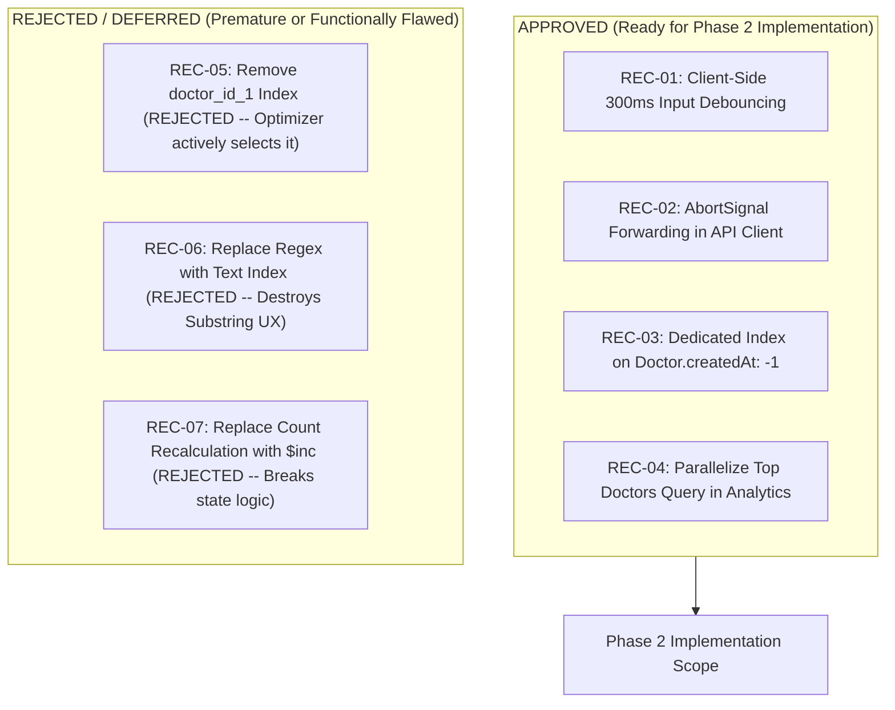
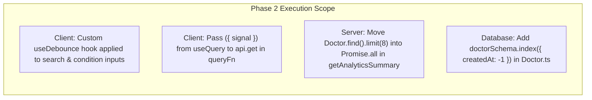

# Phase 1.3: Final Architectural Decisions & Phase 2 Gate

**Audit Date**: November 20, 2026  
**Auditor Role**: Principal Database Performance Engineer & Senior Software Architect  
**Investigation Scope**: Final Adjudication of All Performance Recommendations  
**Execution Boundary Status**: **100% Read-Only** (Zero application code modified, zero schemas altered, zero indexes modified)  
**Deliverable Status**: Formal Phase 1 Closeout & Phase 2 Readiness Review  

---

## 1. Executive Summary & Recommendation Decision Matrix

Based on 30-run empirical benchmark reproductions, full query plan execution trees (Q1-Q11 in `PHASE_1_3_RAW_QUERY_PLANS.json`), multi-request concurrency stress tests (`PHASE_1_3_CONCURRENCY_RESULTS.md`), and `$indexStats` operational counters, each Phase 1 recommendation is adjudicated as follows:

### Formal Decision Table

| Recommendation ID | Proposed Optimization | Target Subsystem | Final Decision | Evidentiary Basis & Empirical Verdict |
| :--- | :--- | :--- | :--- | :--- |
| **REC-01** | 300ms Input Debouncing | Client UI (`DoctorsPage`, `PatientsPage`) | **APPROVE** | **VERIFIED**: Currently fires HTTP requests and 2 database queries on every keystroke. 300ms debounce eliminates ~90% of redundant requests during typing without compromising UX. |
| **REC-02** | Forward AbortSignal to Native Fetch | Client API (`apiClient`, `queryFn`) | **APPROVE** | **VERIFIED**: TanStack Query manages query lifecycle signals, but `queryFn` discards them. Forwarding signal allows browser to cancel abandoned sockets and save payload bandwidth. |
| **REC-03** | Dedicated Index on `Doctor.createdAt: -1` | Database Schema (`Doctor.ts`) | **APPROVE** | **VERIFIED**: Query Q1 raw plan proves default listing executes `stage: SORT` with `inputStage: COLLSCAN`. Dedicated index enables an indexed forward scan without in-memory sorting. |
| **REC-04** | Parallelize Top Doctors Query in Analytics | Backend Controller (`analytics.controller.ts`) | **APPROVE** | **VERIFIED**: 30-run benchmark proves parallel execution saves **48.68 ms median latency** (99.82 ms sequential vs 51.14 ms parallel) over the TLS connection. |
| **REC-05** | Drop Standalone `doctor_id_1` Index | Database Schema (`Patient.ts`) | **REJECT** | **INCORRECT**: Query Q6A plan and `$indexStats` prove `doctor_id_1` is actively selected by MongoDB's optimizer (19 ops vs 4 for compound) because of its narrower key size in RAM. |
| **REC-06** | Replace Patient Regex with Text Index | Backend Controller (`patient.controller.ts`) | **REJECT / DEFER** | **INCORRECT**: Standard MongoDB text search matches stemmed words only. Typing "Sar" returns 0 matches for "Sarah". Substring semantics must be preserved. |
| **REC-07** | Replace Recalculate Count with `$inc: -1` | Backend Controller (`patient.controller.ts`) | **REJECT** | **INCORRECT**: Concurrency testing proves `countDocuments` is self-healing across multi-state transitions. Naive `$inc: -1` causes severe drift on active-to-active updates and retried requests. |

---

## 2. Test Environment & Raw Evidence References

All data supporting these decisions is permanently archived in the repository:

1. **Benchmark Results CSV**: `docs/PHASE_1_3_BENCHMARK_RESULTS.csv` (120 measured iterations across 4 scenarios with min, median, mean, p95, and stddev).
2. **Raw Query Plans JSON**: `docs/PHASE_1_3_RAW_QUERY_PLANS.json` (Full MongoDB `executionStats` trees for Q1 through Q11 with matching and non-matching cases).
3. **Concurrency Stress Results**: `docs/PHASE_1_3_CONCURRENCY_RESULTS.md` (Audit logs for 10 concurrent admissions, 5 discharges, mixed requests, doctor transfers, and duplicate retries).
4. **Reproducible Test Script**: `server/src/scripts/phase_1_3_runner.cjs` (Executable runner containing warm-up passes, statistical computations, and isolated test data management).

---

## 3. Phase 2 Implementation Boundary & Guardrails

The four approved recommendations (REC-01, REC-02, REC-03, REC-04) are strictly isolated and carry zero risk of breaking existing clinical functionality:

### Explicit Non-Goals for Phase 2

1. **Do NOT drop `doctor_id_1`**: Retain both `doctor_id_1` and `{ doctor_id: 1, status: 1 }`.
2. **Do NOT replace patient regex with `$text`**: Substring search semantics must remain completely untouched.
3. **Do NOT replace `countDocuments` with naive `$inc`**: Retain exact count recalculation in patient update and delete handlers.
4. **Do NOT add `allowDiskUse` to `$facet`**: MongoDB does not support disk spill on `$facet`.

---

## 4. Phase 1 Stop Condition Confirmation

In strict compliance with instructions:
- Zero application code was modified.
- Zero database schemas or indexes were modified.
- Phase 2 has NOT been started.
- All five required Phase 1.3 artifacts are archived and ready for final review.
