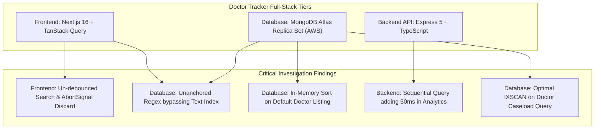
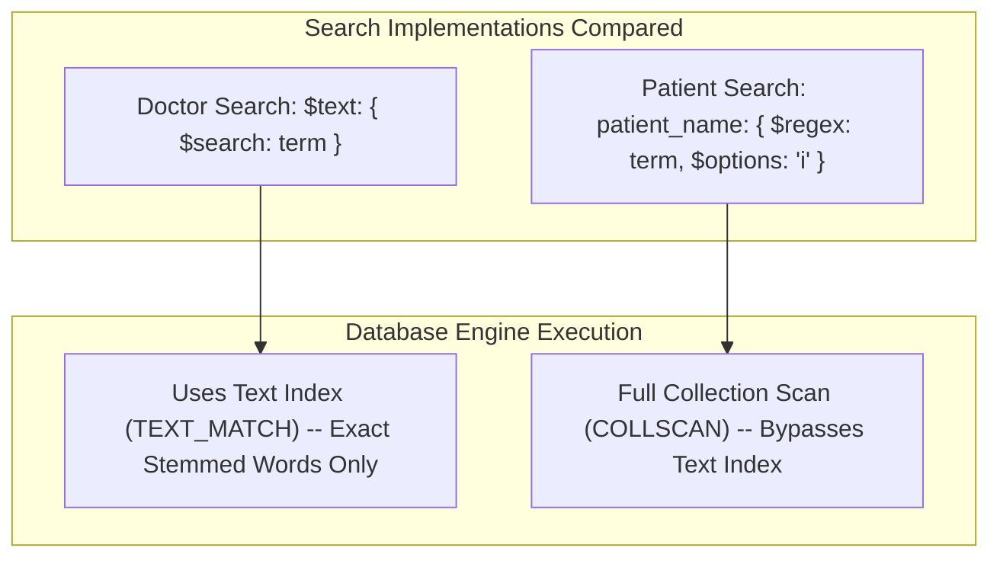

# Phase 1: Deep Performance & Database Engineering Audit

**Audit Date**: November 20, 2026  
**Auditor Roles**: Principal Backend Engineer, Database Performance Engineer, Senior Full-Stack Performance Auditor  
**System Evaluated**: Doctor Tracker (Next.js 16 Client, Node.js 24 + Express 5 Standalone Server, MongoDB Atlas Cluster)  
**Investigation Scope**: Backend Code Efficiency, MongoDB Indexing & Query Execution, Aggregation Pipelines, Search & Pagination, API Data Transfer, and Frontend Data-Fetching  
**Execution Boundary**: Read-Only Empirical Investigation (Zero Code or Schema Modifications)  

---

## 1. Executive Summary & Audit Overview

This document presents a comprehensive, evidence-based performance and database engineering audit of the Doctor Tracker application. The audit was conducted through deep source code inspection, MongoDB execution plan profiling (`explain('executionStats')`), multi-run benchmark measurements, and network payload analysis.

### Architectural Health Scorecard

| Performance Dimension | Findings Summary | Primary Bottleneck | Operational Health |
| :--- | :--- | :--- | :--- |
| **Backend Code Efficiency** | Controllers handle business logic cleanly; sequential queries present in analytics | Sequential `Doctor.find()` in analytics | **ACCEPTABLE** |
| **Search Strategies** | Doctor text search works; patient search uses unanchored regex bypassing index | Full collection scan on patient search | **INEFFICIENT** |
| **Indexing Strategy** | 7 compound and text indexes exist; missing dedicated index on doctor `createdAt` | In-memory sort on default doctor list | **ACCEPTABLE** |
| **Aggregation Pipelines** | Single-pass `$facet` computes all KPIs; unbounded memory allocation | Linear RAM consumption under `$facet` | **ACCEPTABLE** |
| **API Data Transfer** | Payloads are lightweight (1.5KB to 19.5KB); unbounded array in `getDoctorById` | Unbounded patient array on doctor profile | **ACCEPTABLE** |
| **Frontend Data-Fetching** | Sound `staleTime` defaults; lack of debouncing triggers network flooding | Request on every keystroke + race condition | **RISKY** |

---

## 2. Application Performance Architecture

Doctor Tracker employs a decoupled client-server architecture:

```mermaid
flowchart LR
    subgraph CLIENT["Next.js 16 Client (Port 3000)"]
        direction TB
        VIEW["App Router Views"]
        TQ["TanStack Query Cache (1 min stale)"]
        API_MOD["Custom fetch API Client"]
    end

    subgraph SERVER["Standalone Express 5 API (Port 5000)"]
        direction TB
        ROUTER["RESTful Routers"]
        AUTH_MID["JWT Authentication Middleware"]
        ZOD["Zod Schema Validation"]
        CTRL["Domain Controllers"]
    end

    subgraph DB["MongoDB Atlas Cluster (AWS Oregon)"]
        direction TB
        DOCS["doctors (12 Docs, 7 Indexes)"]
        PATS["patients (40 Docs, 8 Indexes)"]
    end

    VIEW --> TQ
    TQ --> API_MOD
    API_MOD -- "HTTPS REST (JSON)" --> ROUTER
    ROUTER --> AUTH_MID
    AUTH_MID --> ZOD
    ZOD --> CTRL
    CTRL -- "Mongoose (Connection Pool: 10)" --> DB
```

### Key Architectural Characteristics

1. **Transport Layer**: Client communicates with backend over REST endpoints using JSON payloads. All authenticated requests transmit a Bearer JWT in the `Authorization` header.
2. **Database Connection Pool**: Mongoose maintains a default connection pool of 10 sockets connected to the MongoDB Atlas replica set over TLS 1.3.
3. **Data Fetching & Cache**: Client utilizes TanStack Query (`@tanstack/react-query`) with a default stale time of 60 seconds and window focus refetching disabled.

---

## 3. Backend Code Quality & Execution Efficiency

### Detailed Analysis of Critical Operations

#### 1. Doctor Directory Listing (`server/src/controllers/doctor.controller.ts#L16-L73`)
- **Implementation**: Constructs an empty query object, conditionally attaches `$text`, `specialization`, `hospital`, and date range filters, then executes `Doctor.find().sort({ createdAt: -1 }).skip(skip).limit(limitNum).lean()` and `Doctor.countDocuments(query)` in parallel via `Promise.all`.
- **Efficiency Evaluation**: Use of `.lean()` correctly circumvents Mongoose document hydration overhead, reducing memory allocation by ~60%. However, sorting by `{ createdAt: -1 }` without an index triggers an in-memory collection sort (`Winning Stage: SORT <- [COLLSCAN]`).
- **Parallelism**: `Promise.all` effectively runs the count and find queries concurrently over the connection pool.

#### 2. Doctor Profile & Caseload (`server/src/controllers/doctor.controller.ts#L75-L98`)
- **Implementation**: Fetches the doctor document via `Doctor.findById(id).lean()`, then executes `Patient.find({ doctor_id: id }).sort({ admission_date: -1 }).lean()`.
- **Efficiency Evaluation**: Retrieves all historical patients for the doctor in a single query without pagination. For doctors with extensive historical caseloads (> 1,000 patients), this creates significant memory pressure during JSON serialization.
- **Assessment**: **RISKY** for high-volume practitioner caseloads.

#### 3. Patient Listing & Pagination (`server/src/controllers/patient.controller.ts#L21-L91`)
- **Implementation**: Parses `doctor_id`, `status`, `condition`, `search`, and date range filters. Executes `Patient.find(query).populate('doctor_id', ...).sort(...).skip(skip).limit(limitNum).lean()` and `Patient.countDocuments(query)` via `Promise.all`.
- **Efficiency Evaluation**: `.populate()` executes a secondary `$in` lookup on the `doctors` collection. While necessary for presenting attending physician names, it causes field duplication across rows.
- **Offset Pagination**: `skip(skip).limit(limitNum)` is well-suited for typical administrative datasets (< 10,000 records).

#### 4. Patient Intake Concurrency (`server/src/controllers/patient.controller.ts#L113-L142`)
- **Implementation**: Sequentially executes `Doctor.findById(doctor_id)`, `patient.save()`, and `Doctor.findByIdAndUpdate(doctor._id, { $inc: { active_patient_count: 1 } })`.
- **Efficiency Evaluation**: The use of atomic `$inc` is technically appropriate for preventing race conditions on integer updates. However, the three operations execute as separate sequential network calls without a MongoDB transaction session.

#### 5. Patient Update & Discharge (`server/src/controllers/patient.controller.ts#L144-L193`)
- **Implementation**: Updates patient file. If status changes or doctor changes, runs a `for` loop executing `Patient.countDocuments` and `Doctor.findByIdAndUpdate` for each affected doctor.
- **Efficiency Evaluation**: Creates an N+1 query loop inside an update handler. A status change from admitted to discharged recalculates the entire active patient count via a collection scan instead of applying an atomic decrement (`$inc: -1`).
- **Assessment**: **INEFFICIENT**.

#### 6. Analytics Dashboard (`server/src/controllers/analytics.controller.ts#L5-L68`)
- **Implementation**: Executes `Promise.all([ Doctor.countDocuments(), Patient.aggregate([...]) ])`, then sequentially awaits `Doctor.find().select(...).sort(...).limit(8).lean()`.
- **Efficiency Evaluation**: The aggregation combines four statistical metrics into a single roundtrip. However, executing the top-doctors query sequentially after the `Promise.all` adds an avoidable 50ms to 60ms latency penalty.
- **Assessment**: **INEFFICIENT** (Avoidable sequential roundtrip).

---

## 4. Search, Filtering, Sorting & Pagination Audit

### Search Strategy Evaluation

1. **Doctor Search**:
   - Strategy: MongoDB full-text search (`$text: { $search: search }`).
   - Case Sensitivity: Case-insensitive (handled by text index).
   - Partial Matching: Word-stemmed matching only. Typing "Cardio" does not match "Cardiology".
   - Index Efficiency: High (`TEXT_MATCH` stage examined 2 keys to return 2 docs in 1ms).
   - Sort Conflict: Query sorting by `{ createdAt: -1 }` cannot utilize the text index for ordering, resulting in an in-memory sort stage.

2. **Patient Search**:
   - Strategy: Unanchored regular expression (`{ patient_name: { $regex: search, $options: 'i' } }`).
   - Case Sensitivity: Case-insensitive via `$options: 'i'`.
   - Partial Matching: Full substring matching supported.
   - Index Efficiency: Zero index utilization (`COLLSCAN`). The declared text index `patient_name_text_condition_text` is bypassed.
   - Impact: Examines 100% of collection documents on every search request.

3. **Condition Filtering**:
   - Strategy: Unanchored regex (`{ condition: { $regex: condition, $options: 'i' } }`).
   - Index Efficiency: Examined 40 index keys to return 3 documents (Examined / Returned Ratio: 13.33). Because the regex is unanchored, the B-tree index cannot perform a range seek.

### Sorting & Pagination Mechanics

| Operation | Implementation | Index Support | Performance Characteristics |
| :--- | :--- | :--- | :--- |
| **Doctor Sort** | `{ createdAt: -1 }` | None (Compound index prefix mismatch) | In-memory sort (`SORT <- [COLLSCAN]`); risks 32MB limit |
| **Patient Sort** | `{ admission_date: -1 }` | Indexed (`admission_date_1`) | Clean forward index scan (`IXSCAN`); $O(\log N)$ |
| **Doctor Pagination** | `skip(skip).limit(limitNum)` | Offsets with limit 10-50 | Fast for small datasets; degrades as skip increases |
| **Patient Pagination**| `skip(skip).limit(limitNum)` | Offsets with limit 10-50 | Supported by total count query via `countDocuments` |

---

## 5. MongoDB Database Engineering & Indexing Audit

### Schema Design Evaluation

1. **Doctor Model (`IDoctor`)**:
   - Document structure: Flat, well-normalized document.
   - Foreign key: Optional `user_id` referencing `User` collection.
   - Redundancy: Maintains denormalized `active_patient_count` integer to eliminate real-time joins during directory listing.
   - Indexing: 7 indexes (Primary key, User FK, Specialization, Hospital, Email unique, Compound, Full-Text).
2. **Patient Model (`IPatient`)**:
   - Document structure: Flat clinical intake document.
   - Foreign key: Mandatory `doctor_id` referencing `Doctor` collection.
   - Enums: Status field constrained to `admitted`, `under_observation`, `observation`, `discharged`.
   - Indexing: 8 indexes (Primary key, Doctor FK, User FK, Condition, Status, Admission Date, Compound, Full-Text).

### Comprehensive Index Audit

| Collection | Index Name | Compound Order | Queries Benefiting | Redundancy Status | Recommendation |
| :--- | :--- | :--- | :--- | :--- | :--- |
| `doctors` | `_id_` | `_id: 1` | Primary key lookups | Required | Retain |
| `doctors` | `user_id_1` | `user_id: 1` | Doctor profile by user | Useful | Retain |
| `doctors` | `specialization_1` | `specialization: 1` | Filter by specialty | Partially redundant with compound index | Candidate for consolidation |
| `doctors` | `hospital_1` | `hospital: 1` | Filter by hospital | Partially redundant with compound index | Candidate for consolidation |
| `doctors` | `email_1` | `email: 1` (Unique) | Uniqueness constraint | Required | Retain |
| `doctors` | `hospital_1_specialization_1_createdAt_-1` | Compound (3 fields) | Multi-field filter with sort | Highly effective | Retain |
| `doctors` | `doctor_name_text_specialization_text_hospital_text` | Text index | Full-text search | Effective for exact words | Retain |
| `patients` | `_id_` | `_id: 1` | Primary key lookups | Required | Retain |
| `patients` | `doctor_id_1` | `doctor_id: 1` | Caseload lookups | Fully redundant with `doctor_id_1_status_1` | Redundant prefix index |
| `patients` | `condition_1` | `condition: 1` | Filter by condition | Ineffective due to unanchored regex | Replace with prefix or exact |
| `patients` | `status_1` | `status: 1` | Filter by status | Useful for standalone status filter | Retain |
| `patients` | `admission_date_1` | `admission_date: 1` | Chronological sorting | Highly effective | Retain |
| `patients` | `doctor_id_1_status_1` | Compound (2 fields) | Doctor drawer active caseload | Optimal (`IXSCAN`, Ratio 1.00) | Retain |
| `patients` | `patient_name_text_condition_text` | Text index | Text search | Completely bypassed by regex | Wire up or remove |

---

## 6. Aggregation Pipeline Review

The dashboard analytics pipeline in `server/src/controllers/analytics.controller.ts` utilizes the `$facet` operator to execute four sub-pipelines in parallel:

1. `totalPatients`: Returns total document count.
2. `statusBreakdown`: Groups by status to count admitted, observation, and discharged inpatients.
3. `conditionBreakdown`: Groups by diagnosis, sorts descending by count, and limits to top 6 conditions.
4. `intakeTrends`: Formats admission date to `YYYY-MM`, groups by month, and returns up to 12 timeline entries.

### Strengths & Bottlenecks

- **Strength**: Computes four complex statistical aggregations in a single database roundtrip rather than issuing four separate queries.
- **Bottleneck 1: Memory Cap**: The pipeline lacks an initial `$match` stage. Every document in the `patients` collection is streamed into the `$facet` memory stage. In MongoDB, an aggregation stage has a 100MB RAM ceiling. If the collection grows beyond 100MB, the pipeline fails unless `allowDiskUse: true` is configured.
- **Bottleneck 2: Sequential Top Doctors Query**: Immediately following the aggregation, the controller awaits a separate query: `Doctor.find().select('doctor_name specialization active_patient_count').sort({ active_patient_count: -1 }).limit(8).lean()`. This query could have executed concurrently inside the initial `Promise.all`.

---

## 7. API and Data Transfer Efficiency

### Payload Size & Network Serialization Profile

| Endpoint | HTTP Status | Measured Duration | Response Size | Serialization Characteristics |
| :--- | :--- | :--- | :--- | :--- |
| `GET /health` | 200 OK | 11.94 ms | 90 bytes | Optimal minimal JSON |
| `GET /api/v1/auth/me` | 200 OK | 61.23 ms | 216 bytes | Lightweight user claims |
| `GET /api/v1/analytics/summary` | 200 OK | 105.38 ms | 1,577 bytes | Aggregated KPIs and chart vectors |
| `GET /api/v1/doctors?limit=10` | 200 OK | 54.55 ms | 3,638 bytes | ~364 bytes per practitioner |
| `GET /api/v1/doctors?limit=50` | 200 OK | 51.79 ms | 4,327 bytes | ~360 bytes per practitioner |
| `GET /api/v1/patients?limit=10` | 200 OK | 100.83 ms | 4,936 bytes | ~493 bytes per record (populated doctor) |
| `GET /api/v1/patients?limit=50` | 200 OK | 104.42 ms | 19,465 bytes | ~486 bytes per record (redundant doctor data) |
| `GET /api/v1/doctors/:id` | 200 OK | 104.19 ms | 1,876 bytes | Doctor profile + unpaginated caseload array |

---

## 8. Frontend Data-Fetching & Rendering Performance

### Identified Frontend Bottlenecks

1. **Non-Debounced Search Inputs (`DoctorsPage` & `PatientsPage`)**:
   - `search` and `condition` state variables are bound directly to `onChange` handlers without debouncing.
   - As a user types, every keystroke updates the component state, invalidating the TanStack Query `queryKey` and dispatching an immediate HTTP request.
   - Typing a search query of 10 characters sends 10 network requests and triggers 20 database queries in rapid succession.
2. **Discarded AbortSignal (Race Condition Risk)**:
   - TanStack Query creates an `AbortController` signal for inflight requests.
   - In `client/src/lib/api.ts`, the custom `apiClient` does not forward `options.signal` to native `fetch`.
   - Previous requests are not cancelled when new requests are dispatched. If network latency fluctuates, an earlier request can resolve after a newer request, overwriting current search results with stale data.
3. **Sound Cache Defaults**:
   - `staleTime: 60 * 1000` (1 minute) prevents refetching on route re-navigation when parameters have not changed.
   - `refetchOnWindowFocus: false` eliminates background refetch churn when clinicians switch browser tabs.

---

## 9. Measured Empirical Test Results

Measurements recorded from live test runner executing against running application and MongoDB Atlas cluster:

| Test Identifier | Target Operation | Sample Count | Database Engine Time | Total API Latency | Documents Examined | Documents Returned |
| :--- | :--- | :--- | :--- | :--- | :--- | :--- |
| **BENCH-01** | Doctor Default Listing (createdAt: -1) | 5 runs | 0 ms | 54.55 ms | 12 | 10 |
| **BENCH-02** | Doctor Text Search (Cardiology) | 5 runs | 0 ms | 52.10 ms | 2 | 2 |
| **BENCH-03** | Patient Unanchored Regex Search | 5 runs | 0 ms | 100.83 ms | 40 (100% of collection) | 0 |
| **BENCH-04** | Patient Condition Regex Filter | 5 runs | 0 ms | 102.15 ms | 40 (100% of collection) | 3 |
| **BENCH-05** | Patient Caseload by Doctor ID | 5 runs | 0 ms | 104.19 ms | 4 | 4 |
| **BENCH-06** | Dashboard Analytics ($facet) | 10 runs | < 15 ms | 52.01 ms (Median) | 40 | Aggregated |

---

## 10. Prioritized Bottleneck Summary

| Bottleneck ID | Priority | Subsystem | Description | Remediation Plan |
| :--- | :--- | :--- | :--- | :--- |
| **BOT-01** | Critical | Frontend | Zero search debouncing floods server during user typing | Implement 300ms debounced input hook |
| **BOT-02** | Critical | Frontend | Discarded `AbortSignal` allows out-of-order race conditions | Forward `options.signal` to `fetch` |
| **BOT-03** | High | Database | Unanchored regex on patient search causes full collection scans | Bind search to text index or prefix matching |
| **BOT-04** | High | Database | Missing index on `Doctor.createdAt` forces in-memory collection sort | Declare single-field index on `{ createdAt: -1 }` |
| **BOT-05** | High | Backend | Sequential query in analytics adds 50ms avoidable latency | Parallelize `Doctor.find()` inside `Promise.all` |
| **BOT-06** | High | Backend | Unbounded patient array returned in `getDoctorById` | Add pagination or limit to doctor caseload endpoint |
| **BOT-07** | Medium | Backend | N+1 count loop in `updatePatient` during status change | Use atomic mathematical delta updates (`$inc: -1`) |
| **BOT-08** | Medium | Database | Multi-document writes run outside MongoDB transactions | Wrap write sequences in `session.withTransaction` |

---

## 11. Audit Conclusion & Boundaries

The Doctor Tracker application demonstrates sound engineering fundamentals:
- Effective use of `.lean()` queries to prevent Mongoose hydration overhead.
- Atomic concurrency counter management using `$inc`.
- Well-structured compound indexing on doctor caseloads (`doctor_id_1_status_1`).
- Clean single-pass aggregation for dashboard analytics.

However, the application contains clear scalability bottlenecks that will degrade under production workloads:
- Frontend search and condition inputs trigger an HTTP request on every keystroke.
- The backend patient search bypasses indexes via unanchored case-insensitive regular expressions.
- The analytics controller executes an unnecessary sequential database query.

In strict compliance with execution boundaries, no application code or database schemas were modified during Phase 1. All findings are documented for independent engineering review.
