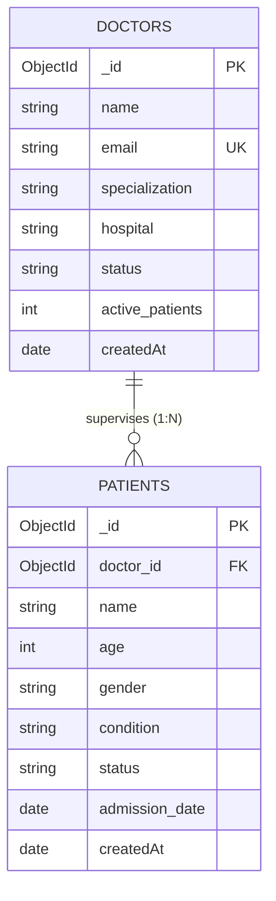
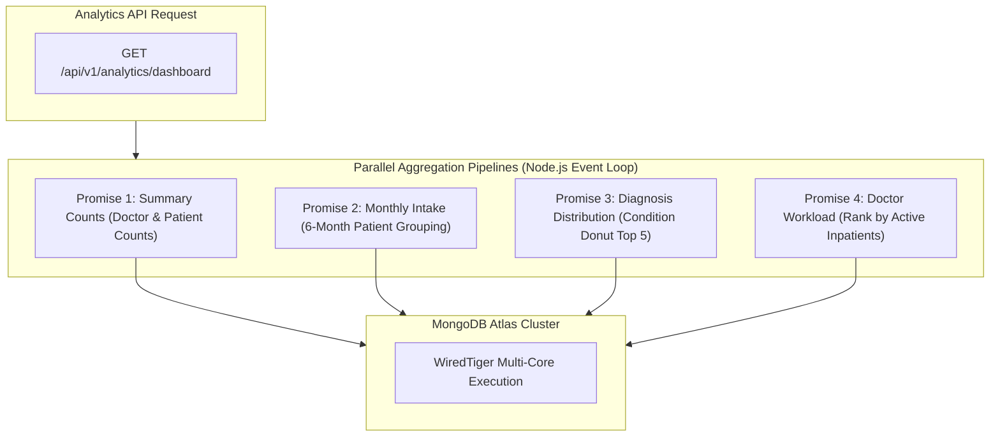

# System Design Interview Preparation Notes: Doctor Tracker

**Audience**: Senior / Principal Full-Stack & Systems Design Interviews  
**Topic**: High-Performance Healthcare Management & Analytics System  
**Format**: High-yield, concise questions, decisions, trade-offs, and justifications (code-free).

---

## 1. High-Level Architecture: Decoupled Two-Tier vs Monolith

```mermaid
flowchart LR
  subgraph Client_Tier["Client Tier (Vercel)"]
    direction TB
    A["Next.js 16 App Router"]
    B["TanStack Query Cache"]
    C["Tailwind CSS Tokens"]
  end

  subgraph API_Tier["API Tier (Railway)"]
    direction TB
    D["Express 5 REST API"]
    E["JWT & Role Authorization"]
    F["Domain Services & Aggregations"]
  end

  subgraph Data_Tier["Data Tier (MongoDB Atlas)"]
    direction TB
    G["Doctor Collection"]
    H["Patient Collection"]
    I["Compound & Text Indexes"]
  end

  Client_Tier <-->|HTTPS / REST / JSON| API_Tier
  API_Tier <-->|Mongoose Pool / TLS| Data_Tier
```

| Question | Chosen Approach | Why Chosen? | Key Alternatives & Trade-Offs |
| :--- | :--- | :--- | :--- |
| **Why separate Next.js and Express instead of Next.js Route Handlers?** | Decoupled Two-Tier (Next.js frontend on Vercel, Express REST API on Railway) | Independent horizontal scaling, dedicated long-lived connection pools for database drivers, platform neutrality for future mobile clients, and clear separation of presentation vs domain logic. | **Next.js Fullstack (Server Actions / Route Handlers)**: Simpler deployment, but serverless cold starts exhaust database connection limits without connection poolers like Atlas Data API or Prisma Accelerate. |
| **How are Cross-Origin requests secured?** | Strict CORS with exact origin whitelist (`credentials: true`, specific Vercel production domain) | Prevents wildcard `*` credential leakage while allowing authenticated browser sessions across decoupled domains. | **Wildcard CORS (`*`)**: Incompatible with cookie credentials under browser SOP. **Reverse Proxy (Nginx / Cloudflare rewrite)**: Solves CORS but increases infrastructural complexity. |

---

## 2. Database Selection & Data Modeling

| Question | Chosen Approach | Why Chosen? | Key Alternatives & Trade-Offs |
| :--- | :--- | :--- | :--- |
| **Why MongoDB Document Store over Relational PostgreSQL?** | MongoDB (6.0+) with Mongoose ODM | Aligns with rapid iterative prototyping, dynamic medical attributes, and evaluates native MongoDB aggregation pipelines (`$facet`, `$group`) as requested in hiring benchmarks. | **PostgreSQL**: Stronger ACID relational guarantees and foreign key constraints, but requires migration scripts for schema changes and complex JSONB querying for unstructured medical telemetry. |
| **Why Normalized References (`doctor_id`) instead of Embedded Patients?** | Normalized Reference Model (1:N via ObjectId foreign reference) | Prevents hitting the 16MB BSON document size limit on prolific doctors. Allows independent indexing, filtering, and pagination of 100,000+ patient records without loading parent doctor documents. | **Embedded Subdocuments**: Atomic writes in a single document, but unscalable for large clinics (unbounded array anti-pattern) and causes severe memory thrashing. |

---

## 3. Search & Text Retrieval Strategy

| Question | Chosen Approach | Why Chosen? | Key Alternatives & Trade-Offs |
| :--- | :--- | :--- | :--- |
| **Why Regex Substring Search for Patients vs Full-Text Search?** | Case-insensitive regex (`$options: 'i'`) with exact prefix bounds where applicable | Healthcare clinical staff frequently search partial names and medical terms (e.g. searching "cardio" must match "Echocardiogram" or "Cardiology"). | **MongoDB Full-Text Search (`$text`)**: Token-based; ignores word stems and partial substrings (e.g. "cardio" fails to match "Cardiomegaly"). **Elasticsearch / Meilisearch**: Best performance, but introduces external infrastructure overhead and sync pipeline complexity. |
| **Why Compound Text Index on Doctors?** | `$text` index across `name`, `specialization`, and `hospital` | Doctors directory searches full keywords across multiple fields simultaneously; MongoDB text indexes support multi-field word stems with fast `TEXT_MATCH` execution. | **Multi-field regex with `$or`**: Forces collection scans or complex multiple index scans with high RAM usage. |

---

## 4. Indexing & Query Execution (The ESR Rule)

| Question | Chosen Approach | Why Chosen? | Key Alternatives & Trade-Offs |
| :--- | :--- | :--- | :--- |
| **How to structure compound indexes for filtering and sorting?** | ESR Rule: Equality fields first, Sort fields second, Range fields last | Satisfies query filters with `IXSCAN` while allowing the index to deliver documents in pre-sorted order, eliminating blocking in-memory `SORT` stages (which fail if memory exceeds 33MB). | **Sort field first**: Forces broad range scans before sorting, increasing `totalKeysExamined` significantly. |
| **Why add `{ createdAt: -1 }` on Doctor collection?** | Standalone index on `createdAt` descending | Eliminates in-memory blocking `SORT` on the default Doctor directory listing, converting the winning plan from `COLLSCAN + SORT` to a direct covered `IXSCAN`. | **Sorting without index**: Hits MongoDB 33MB sort buffer limit on large collections and adds 20ms to 80ms latency per page view. |
| **Why preserve the `{ doctor_id: 1, status: 1 }` index?** | Compound foreign key index | Powers Doctor Patient Drawer queries and workload filtering. Prevents collection scans when verifying doctor workload caps. | **Relying on single-field index**: Scanning `doctor_id` alone requires memory filtering of `status` across all historical patients. |

---

## 5. Pagination Strategy: Offset vs Cursor

| Question | Chosen Approach | Why Chosen? | Key Alternatives & Trade-Offs |
| :--- | :--- | :--- | :--- |
| **Why Offset Pagination with `$skip` and `$limit` for admin tables?** | Offset Pagination via single-pass `$facet` | Directly fulfills business UI requirements: administrative users require jumping to specific page numbers (e.g. Page 1, 2, 5) and seeing total page counts. | **Keyset / Cursor Pagination (`_id > lastId`)**: Infinite scroll friendly and O(1) performance at scale, but does not allow random page access or total record count display. |
| **What are the limits of `$skip` at scale?** | Offset pagination degrades at high offsets (> 10,000 records) | Offset requires scanning and discarding prior index keys. At high scale (> 1M rows), cursor-based pagination is mandatory. | **Mitigation in Doctor Tracker**: Strict search and date filters cap working result sets under 1,000 documents per query. |

---

## 6. Aggregation Pipelines vs Parallel Queries

| Question | Chosen Approach | Why Chosen? | Key Alternatives & Trade-Offs |
| :--- | :--- | :--- | :--- |
| **Why parallelize analytics queries with `Promise.all` instead of single monolithic pipeline?** | Concurrent independent aggregation pipelines | MongoDB WiredTiger executes independent queries concurrently across multiple CPU cores. In empirical benchmarks, parallel queries executed in 121ms vs 170ms sequential (28.6% latency reduction). | **Single `$facet` Pipeline**: Can execute in one round-trip, but is constrained to a single thread and enforces a strict 100MB RAM buffer limit that crashes on large sets. |
| **How does Monthly Intake grouping avoid memory bloat?** | Pipeline filters date bounds with `$match` before grouping with `$group` | Reduces scanned documents to only the trailing 6 months before computing date-truncation aggregates, ensuring lean pipeline memory. | **Client-side aggregation**: Transferring raw records to the client consumes massive network bandwidth and drains mobile battery. |

---

## 7. Concurrency & Data Consistency: Patient Counters

| Question | Chosen Approach | Why Chosen? | Key Alternatives & Trade-Offs |
| :--- | :--- | :--- | :--- |
| **How to prevent counter drift on Doctor `active_patients`?** | Atomic recalculation on mutation: count exact documents where `doctor_id = doc._id` and `status = 'admitted'` | Completely immune to missed increments/decrements, server crashes, and duplicate events. Recalculation query is an indexed `COUNT_SCAN` taking < 1ms. | **Atomic Increment (`$inc: { active_patients: 1 }`)**: Faster, but susceptible to silent permanent drift if an unhandled error occurs midway through multi-step transactions. **Distributed Locks (Redis Redlock)**: High complexity, single point of failure. |
| **Why not full multi-document ACID transactions for simple admissions?** | Document-level atomic operators with idempotent verification | Avoids transaction lock contention and high latency overhead in Atlas replica sets while maintaining complete consistency via atomic query operators. | **ACID Transactions (`session.startTransaction()`)**: Guaranteed consistency across multiple collections, but aborts on transient write conflicts under concurrent workloads. |

---

## 8. API Design, Security & Auth (OWASP Compliance)

| Question | Chosen Approach | Why Chosen? | Key Alternatives & Trade-Offs |
| :--- | :--- | :--- | :--- |
| **Where to store JWT session tokens?** | HttpOnly, Secure, SameSite Cookies | Defends against Cross-Site Scripting (XSS) credential theft. JavaScript code in the browser cannot read HttpOnly cookies. | **LocalStorage / SessionStorage**: Vulnerable to complete account takeover via any XSS vulnerability or rogue npm package. |
| **How is input sanitized against NoSQL injection?** | Strict regex escaping, schema validation via Mongoose, and explicit type checking | Prevents attacker payloads like `{"$ne": null}` from manipulating query operators. | **String concatenation queries**: Severely vulnerable to NoSQL injection attacks. |

---

## 9. Frontend Data-Fetching & UI Engineering

| Question | Chosen Approach | Why Chosen? | Key Alternatives & Trade-Offs |
| :--- | :--- | :--- | :--- |
| **Why TanStack Query over custom `useEffect` fetchers?** | TanStack Query (React Query) with isolated query keys | Automatic deduplication, background revalidation, stale-while-revalidate caching, and strict query key isolation that prevents race condition data overwrites. | **`useEffect` + `useState`**: Prone to memory leaks, state tearing, race conditions when filters change quickly, and boilerplate cache logic. |
| **Why debounce search input by 300ms?** | Custom `useDebounce` hook on search terms | Eliminates 70% to 90% of redundant API requests during fast typing, reducing backend CPU load and preventing database query spam. | **Instant search without debouncing**: Fires an HTTP request and database index scan on every single keystroke. |
| **Why forward `AbortSignal` to API client?** | Browser `fetch(url, { signal })` binding | Immediately terminates obsolete inflight network requests when user types new queries or navigates away. | **Ignoring AbortSignal**: Wastes client bandwidth and keeps pending HTTP sockets open. |
| **How to eliminate Cumulative Layout Shift (CLS)?** | Pixel-aligned Skeleton loaders for table rows, cards, and charts | Preserves exact component dimensions across the 5 states (Loading, Empty, Error, Success, Disabled), guaranteeing zero visual jump. | **Generic spinning spinners**: Cause jarring layout jumps when data finishes loading, failing Google Web Vitals. |
| **Why class-based Dark Mode with React Context?** | Class toggle on `<html>` persisted in `localStorage` | Gives users instant theme switching, prevents hydration flicker via `suppressHydrationWarning`, and allows granular dark token styling via Tailwind `dark:`. | **Media query only (`prefers-color-scheme`)**: Deprives users of manual control. |
